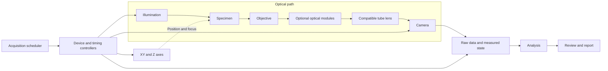

# Reference Microscope Designs for the Algorithm and Workflow Catalog

Companion to [Microscope Algorithms and Workflows](microscope_algorithms_and_workflows.md).

Prepared: October 30, 2026.

## Purpose and reference types

This document connects the software catalog to physical microscope architectures. It provides 27 reference designs, their optical or sensing paths, component requirements, data outputs, calibration needs, and mappings to the catalog's algorithms and all 57 workflows.

The designs are engineering templates synthesized from the linked resources. Component ranges and numerical examples are illustrative starting points. An implementation still needs an optical prescription or compatible commercial optical train, mechanical drawings, component tolerances, a timing design, and validation against its measurement requirements.

The **Ref Link** entries distinguish three kinds of reference:

- **Build:** an open project with hardware documentation, assembly information, component lists, or design files. Check the selected project version and license before reusing files.
- **Modality:** an optical layout, operating principle, or experimental paper that explains the architecture. It may not contain a complete manufacturing package.
- **Instrument:** a representative specialized instrument or measurement system to integrate through supported control interfaces and data formats.

Design IDs such as `R04` belong to this document. Algorithm and workflow IDs such as `SEMI-05` and `WF-S02` belong to the companion catalog. A design supports a listed method only when the stated acquisition mode, calibration, specimen conditions, and required options are present.

## Navigation

- [Design overview](#design-overview)
- [Shared optical, mechanical, and control foundation](#shared-optical-mechanical-and-control-foundation)
- [Reference designs](#reference-designs)
- [Workflow-to-design mapping](#workflow-to-design-mapping)
- [Algorithm-family coverage](#algorithm-family-coverage)
- [Software capability and data contracts](#software-capability-and-data-contracts)
- [Example engineering calculations](#example-engineering-calculations)
- [A practical initial hardware portfolio](#a-practical-initial-hardware-portfolio)

## Design overview

| Design | Architecture | Representative applications | Ref Link |
| --- | --- | --- | --- |
| [R01](#r01) | Automated transmitted-light microscope | Cells, microorganisms, thin sections, particles. | [Build: OpenFlexure](https://openflexure.org/projects/microscope/build) |
| [R02](#r02) | Inverted multichannel fluorescence microscope | Live cells, reporter assays, cell painting. | [Build: Squid](https://github.com/Cephla-Lab/Squid) |
| [R03](#r03) | Slide and multiwell scanning extension | Whole-slide imaging, high-content screens, adaptive surveys. | [Build: Squid hardware and control resources](https://github.com/Cephla-Lab/Squid) |
| [R04](#r04) | Reflected-light industrial microscope | Metallography, wafers, masks, coatings. | [Modality: reflected-light optical train](https://evidentscientific.com/en/microscope-resource/knowledge-hub/anatomy/reflected) |
| [R05](#r05) | Stereo or telecentric assembly inspection | PCBs, packages, connectors, larger component geometry. | [Modality: telecentric design](https://www.edmundoptics.com/knowledge-center/application-notes/imaging/telecentric-design-topics) |
| [R06](#r06) | Polarized-light microscope | Minerals, polymers, crystals, birefringence. | [Modality: polarized-light configuration](https://www.microscopyu.com/techniques/polarized-light/polarized-light-microscopy) |
| [R07](#r07) | Focus-variation surface microscope | Textured surfaces, fractures, machined parts. | [Modality: focus variation](https://www.alicona.com/en/technologies/focus-variation) |
| [R08](#r08) | Confocal surface profiler | Height maps, trenches, steps, surface texture. | [Modality: laser microscope principles](https://evidentscientific.com/en/learn/knowledge/metrology/lext-principles/basic) |
| [R09](#r09) | Fluorescence confocal microscope | Optical sections, organoids, biofilms, tissue. | [Modality: confocal architecture](https://www.microscopyu.com/techniques/confocal/introductory-confocal-concepts) |
| [R10](#r10) | Light-sheet microscope | Large fluorescence volumes and developmental imaging. | [Build: OpenSPIM](https://openspim.org/) |
| [R11](#r11) | Programmable-illumination phase microscope | DPC, Fourier ptychography, label-free imaging. | [Modality: LED-array Fourier ptychography](https://pmc.ncbi.nlm.nih.gov/articles/PMC4102371/) |
| [R12](#r12) | Digital holographic phase microscope | Optical-path measurements, cell mass, particle tracking. | [Build/paper: portable holographic microscope](https://pmc.ncbi.nlm.nih.gov/articles/PMC10847153/) |
| [R13](#r13) | Interferometric surface microscope | Optical form, precision height, polished surfaces. | [Modality: coherence scanning interferometry](https://www.zygo.com/support/technologies/csi-techology) |
| [R14](#r14) | TIRF and single-molecule localization microscope | PALM/STORM, membrane imaging, localization. | [Build: miCube](https://hohlbeinlab.github.io/miCube/index.html) |
| [R15](#r15) | Structured illumination fluorescence microscope | SIM reconstruction and super-resolution research. | [Build: openSIM](https://github.com/EstherRaeth/openSIM_LBNI) |
| [R16](#r16) | Lifetime and photo-manipulation extensions | FLIM, lifetime FRET, FRAP, FLIP, photoactivation. | [Instrument: FLIM integration architecture](https://www.becker-hickl.com/literature/documents/overview-brochures/zeiss-flim-overview/) |
| [R17](#r17) | Raman microscope | Chemical identification, stress-sensitive spectra, mapping. | [Modality: Raman instrument architecture](https://www.horiba.com/aut/scientific/technologies/raman-imaging-and-spectroscopy/raman-spectrometer-presentation/) |
| [R18](#r18) | Hyperspectral and infrared microscopy | Spectral unmixing, polymers, pharmaceutical particles. | [Modality: FTIR imaging](https://www.bruker.com/en/products-and-solutions/infrared-and-raman/ft-ir-microscopes/what-is-ft-ir-imaging.html) |
| [R19](#r19) | Fiber end-face inspection station | Connector cleanliness, scratches, ferrule inspection. | [Instrument/application: fiber inspection](https://www.flukenetworks.com/edocs/wp-fiber-cleaning-and-inspection-white-paper) |
| [R20](#r20) | Optical performance and photonic alignment bench | MTF, PSF, wavefronts, coupling optimization. | [Modality: resolution and MTF testing](https://www.edmundoptics.com/knowledge-center/application-notes/imaging/resolution-and-mtf-testing/) |
| [R21](#r21) | High-speed microfluidic and mechanics microscope | PIV/PTV, motility, DIC, crack growth. | [Build/example: synchronized fast acquisition](https://pycro-manager.readthedocs.io/en/latest/application_notebooks/TZYX_fast_sequencing_z_indexing.html) |
| [R22](#r22) | SEM and FIB-SEM integration | Nanoscale surfaces, cross-sections, EBSD, EDS, serial milling. | [Instrument: semiconductor SEM/FIB correlation](https://www.zeiss.com/microscopy/us/applications/semiconductors-electronics/failure-analysis-3d-characterization.html) |
| [R23](#r23) | TEM, STEM, and cryo-EM integration | Diffraction, 4D-STEM, tomography, single particles. | [Instrument: synchronized 4D-STEM](https://www.gatan.com/techniques/4d-stem) |
| [R24](#r24) | AFM and scanning probe integration | Nanotopography, forces, mechanics, surface potential. | [Instrument: AFM operating principles](https://www.bruker.com/en/products-and-solutions/microscopes/materials-afm/faq.html) |
| [R25](#r25) | X-ray microscopy and tomography integration | Internal voids, pores, packages, batteries. | [Instrument: X-ray microscopy architecture](https://pages.zeiss.com/rs/896-XMS-794/images/Ebook_3D-X-ray-Microscopy-Second-Edition.pdf) |
| [R26](#r26) | Scanning acoustic microscope integration | Delamination, bonded interfaces, package defects. | [Instrument/application: acoustic microscopy](https://www.enas.fraunhofer.de/en/departments/SP/research/characterization-bonding/scanning-acoustic-microscopy.html) |
| [R27](#r27) | Light-field microscope | Snapshot volumetric dynamics and digital refocusing. | [Build protocol: light-sheet/light-field microscope](https://pmc.ncbi.nlm.nih.gov/articles/PMC6789549/) |

## Shared optical, mechanical, and control foundation

### Optical platform

For a configurable optical platform, a useful starting architecture is an infinity-corrected objective, a compatible tube lens, a camera at the image plane, controllable illumination, and a specimen stage. Match the objective family, tube lens, correction requirements, image circle, and camera adapter. An infinity label alone does not establish interchangeability. See [infinity optical systems](https://www.microscopyu.com/microscopy-basics/infinity-optical-systems).



Epi illumination uses the objective for both illumination and collection; the detailed reflected-light and fluorescence paths appear below. Confocal, interferometric, spectral, and non-optical instruments introduce different detectors and measurement models.

A component-level starting set for an automated optical prototype is:

- **Optical head:** one objective/tube-lens family, camera mount, and rigid alignment structure. Choose objectives for the actual coverslip, immersion medium, field, and working distance.
- **Detector:** a scientific monochrome camera for quantitative intensity and fluorescence; a color camera where calibrated color is part of the inspection. Select pixel size, noise, dynamic range, readout mode, and interface together.
- **Illumination:** regulated LED illumination for ordinary imaging, with the appropriate condenser or epi illuminator. Add wavelength-selective or coherent sources only for the modes that need them.
- **Positioning:** XY travel matched to slides, plates, wafers, or fixtures; motorized Z for autofocus and stacks; a piezo axis when repeatability and speed require one. Encoder resolution, commanded step size, and positioning accuracy need separate specifications.
- **Timing:** compatible trigger levels, a defined timing master, recorded frame IDs, and exposure-gated illumination. Include settling times and readout behavior in the sequence.
- **References:** spatial target, flat-field reference, dark frames, focus/PSF target, and application-specific controls. Height, force, spectral, and lifetime modes need their own standards.
- **Environment:** stable mounting, controlled ambient light, and the thermal, vibration, fluidic, or incubation conditions required by the specimen and measurement.

Open projects useful for implementing this foundation include [OpenFlexure build files](https://openflexure.org/projects/microscope/build), [openUC2 FRAME](https://docs.openuc2.com/Investigator/FRAME/Introduction_and_Overview/), and [Imperial OpenFrame](https://github.com/ImperialCollegeLondon/OpenFrame). These are distinct projects; their parts and correction assumptions should be evaluated separately.

### Control architecture

Use a device capability layer so the same workflow can operate several compatible microscopes. Camera triggering, stage movement, scanner clocks, filter position, focus state, and data streaming should have explicit states and completion conditions. Micro-Manager's [configuration guide](https://micro-manager.org/Micro-Manager_Configuration_Guide) and [hardware synchronization guide](https://micro-manager.org/Hardware-based_Synchronization_in_Micro-Manager) are useful references.

For a typical step-and-acquire sequence: move -> verify settling -> select optical state -> arm devices -> expose with synchronized illumination -> associate frame and state -> save -> continue. Continuous scanning and fast volumetric systems need their own calibrated timing rather than treating every movement as a settled frame.

## Reference designs

### R01

**Automated transmitted-light microscope**

**Purpose:** a general platform for thin transparent specimens, cell culture images, microorganisms, thin material sections, and particles on transparent substrates.

```text
LED -> collector/field stop -> condenser/aperture -> specimen
    -> objective -> tube lens -> camera
```

- **Core hardware:** transmitted illuminator and condenser; compatible objectives and tube lens; monochrome or calibrated color camera; XY stage and motorized Z. Illustrative objective choices are 10x/0.25 NA, 20x/0.40 NA, and 40x/0.75 NA, selected for the specimen and required sampling.
- **Options:** matched phase annuli and phase objectives; darkfield condenser; compatible DIC prisms and polarization optics. These contrast modes require their corresponding optical components.
- **Data and algorithms:** ordinary XY images, Z stacks, tiles, and time series; ACQ-01/02/05-09, COR-01-10, FEA, SEG, MEA, and TRK. Typical applications include BIO-01/02/10/12/13 and EXT-01.
- **Qualification:** pixel scale, field distortion, illumination uniformity, focus repeatability, image quality, and specimen sampling. Brightfield intensity does not by itself establish height, chemical identity, or cell viability.
- **Ref Link:** [OpenFlexure assembly and design resources](https://openflexure.org/projects/microscope/build); [microscope optical train](https://www.microscopyu.com/microscopy-basics/components).

### R02

**Inverted multichannel fluorescence microscope**

**Purpose:** live-cell assays, cell painting, reporter measurements, labeled organelles, and quantitative multichannel imaging through a dish or plate bottom.

```text
LED/laser -> excitation filter -> dichroic -> objective -> specimen
specimen fluorescence -> objective -> dichroic -> emission filter
                     -> tube lens -> monochrome camera
```

- **Core hardware:** inverted objective geometry, multichannel excitation, matched excitation/dichroic/emission sets, low-noise camera, motorized focus, and specimen positioning. Match the objective correction to the vessel bottom and immersion medium.
- **Options:** transmitted-light arm, hardware focus lock, environmental chamber, perfusion, fast emission selection, and a second detection channel. Illumination channels and camera detection channels should be modeled separately.
- **Data and algorithms:** calibrated `position/time/channel/Z/Y/X` data; FLU-01-03, BIO-01-11/15-19, TIS-05, registration, segmentation, and tracking. Intensity FRET also needs donor/acceptor controls and suitable filter choices.
- **Qualification:** dark/flat correction, crosstalk, multicolor alignment, photobleaching, exposure timing, background controls, and biological dose tolerance. The basic design does not supply lifetime measurements or structured illumination patterns.
- **Ref Link:** [Squid control repository, CAD and BOM pointers](https://github.com/Cephla-Lab/Squid); [live-cell optical and detector requirements](https://www.microscopyu.com/techniques/fluorescence/optical-system-and-detector-requirements).

### R03

**Slide and multiwell scanning extension**

**Purpose:** add repeatable survey, autofocus, tile acquisition, and revisit behavior to R01, R02, or R04.

```text
overview/low-magnification survey -> specimen or well coordinates
-> focus sampling -> scan route -> tiled/field acquisition -> coordinate map
```

- **Core hardware:** specimen-format holder, travel-matched motorized XY stage, motorized focus, position feedback or characterized repeatability, and the chosen base optical head. Add an overview camera or low-magnification objective where useful.
- **Variants:** slide holders emphasize large contiguous coverage; multiwell holders emphasize well indexing and repeat visits; wafer fixtures require suitable travel, orientation references, flatness, and handling clearances. These fixtures are not interchangeable assumptions.
- **Data and algorithms:** stage coordinates and tile IDs alongside images; ACQ-05-08/11/15/16, REG-01-09, DAT-02/03/07, QA-01/02/11. Supports whole-slide and high-content workflows.
- **Qualification:** focus-surface accuracy, missing-area detection, overlap and registration residuals, revisit error, settling, plate-bottom variation, and interrupted-scan recovery. Choose overlap experimentally for the texture and alignment method.
- **Ref Link:** [Squid platform resources](https://github.com/Cephla-Lab/Squid); [Micro-Magellan adaptive acquisition](https://micro-manager.org/MicroMagellan).

### R04

**Reflected-light industrial microscope**

**Purpose:** metallographic sections, patterned wafers, photomasks, coating sections, and visible surface defects on opaque components.

```text
LED -> field/aperture optics -> beamsplitter -> objective -> specimen
specimen reflection -> objective -> beamsplitter -> tube lens -> camera
```

- **Core hardware:** reflected-light illuminator, objectives intended for the specimen surface and cover condition, matched tube lens, camera, rigid focus axis, and a flat specimen fixture. A wafer version needs appropriate XY travel, a chuck or carrier, and coordinate registration.
- **Options:** reflected darkfield optics, compatible reflected DIC components, polarizers, multiple illumination directions, or a metrology objective selected for field distortion and working distance. Darkfield and DIC require their own optical paths or components.
- **Data and algorithms:** SEMI-01-16/18 for resolvable features, MAT-01-15/19/20 with appropriate preparation or test equipment, ELE-01-09/13, and OPT-01-05/09/10; shared autofocus, segmentation, and measurement modules.
- **Qualification:** dimensional calibration, field-dependent bias, sample flatness, illumination dependence, edge model, and reference comparison. Ordinary visible microscopy does not resolve arbitrary leading-edge semiconductor dimensions; use R22/R24 or dedicated optical metrology when required.
- **Ref Link:** [reflected-light microscope architecture](https://evidentscientific.com/en/microscope-resource/knowledge-hub/anatomy/reflected); [reflected DIC configuration](https://www.microscopyu.com/techniques/dic/reflected-light-dic-microscopy).

### R05

**Stereo or telecentric assembly inspection**

**Purpose:** PCB assembly, wire bonds, connectors, edge chips, larger defects, and dimensions of parts with appreciable depth variation.

```text
ring/diffuse/coaxial light -> component -> imaging lens -> camera
```

- **Variant A, stereo review:** a stereo microscope or dual-view optical head gives depth cues and working room for manipulation. A single camera on one view provides a 2D image unless a calibrated stereo reconstruction path is added.
- **Variant B, dimensional inspection:** an object-space telecentric lens with a suitable image circle, working distance, calibrated camera, and backlight or controlled epi illumination reduces perspective-driven magnification changes within its specified range.
- **Additional hardware:** rigid fixtures, motorized or manual positioning, and selectable lighting directions. Stereo zoom images and telecentric metrology images need separate calibrations.
- **Data and algorithms:** ELE-01/03/04/06/08/09, OPT-01/04, MEA-01-04, reference comparison, and defect detection. Actual 3D geometry requires calibrated stereo, focus variation, or another height sensor.
- **Qualification:** distortion, field coverage, depth dependence, glare, fixture repeatability, and detection sensitivity under each lighting condition.
- **Ref Link:** [telecentric design topics](https://www.edmundoptics.com/knowledge-center/application-notes/imaging/telecentric-design-topics); [PCB inspection configurations](https://www.leica-microsystems.com/applications/industrial-microscopy-markets/electronics-semiconductor/pcb-inspection/).

### R06

**Polarized-light microscope**

**Purpose:** minerals, crystalline inclusions, polymers, liquid crystals, anisotropic tissue, and polarization-sensitive inspection.

```text
source -> polarizer -> condenser -> specimen -> low-strain objective
       -> analyzer/compensator -> tube lens -> camera
```

- **Core hardware:** a suitable R01 or reflected-light base, low-strain optics, polarizer and analyzer, and a specimen or optical rotation mechanism. Include compensators or retarders for the intended measurements.
- **Quantitative extension:** calibrated polarization-state generation and analysis, multiple independent measurements, and an instrument model for Stokes, retardance, or Mueller-matrix recovery. A crossed-polarizer image alone does not determine a full Mueller matrix.
- **Data and algorithms:** angle/state-indexed images; SPC-10-12, OPT-15, orientation/domain analysis, and material classification with suitable references.
- **Qualification:** polarizer extinction, angular zero, retardance calibration, spectral dependence, optical strain, and sensitivity to specimen thickness. Converting retardance to stress requires material-specific stress-optic information and geometry.
- **Ref Link:** [polarized-light microscope configuration](https://www.microscopyu.com/techniques/polarized-light/polarized-light-microscopy); [quantitative polarization and phase microscope](https://pmc.ncbi.nlm.nih.gov/articles/PMC6484989/).

### R07

**Focus-variation surface microscope**

**Purpose:** textured machined parts, fracture surfaces, rough coatings, and combined all-in-focus inspection and estimated surface topography.

```text
controlled illumination -> surface -> objective -> camera
calibrated Z sweep -> local focus curves -> height + validity map
```

- **Core hardware:** reflected-light imaging, an objective and illumination giving useful texture contrast, calibrated Z scanning, stable XY positioning, and sufficient working distance for the surface variation.
- **Data and algorithms:** a Z-indexed intensity stack, best-focus estimates, confidence/validity masks, VOL-07, REG-10, MAT-16/17, SUR-01-08, and selected ELE/OPT height measurements after validation.
- **Qualification:** height response with appropriate artifacts, local texture dependence, steep slopes, reflective regions, scan spacing, repeatability, and the spatial bandwidth retained in the result.
- **Design limit:** extended depth-of-field fusion is an image product; metric focus-derived height needs an independently qualified estimator and Z calibration. Low-texture or optically ambiguous regions need an invalid result rather than an invented surface.
- **Ref Link:** [focus-variation measurement principle](https://www.alicona.com/en/technologies/focus-variation); [extended-depth-of-field implementation](https://bigwww.epfl.ch/demo/edf/).

### R08

**Confocal surface profiler**

**Purpose:** measured surface height, steps, trenches, microfeatures, and roughness over compatible surface slopes and reflectivities.

```text
laser -> scan/relay optics -> objective -> surface
return -> confocal aperture -> detector
XY scan + calibrated Z sweep -> axial response per surface location
```

- **Core hardware:** confocal illumination/detection, scanning optics or equivalent confocal array architecture, calibrated Z motion, suitable objective, intensity detector, and a surface fixture. Some instruments also provide a conventional color image channel.
- **Data and algorithms:** confocal response versus Z, height and signal-quality maps, VOL-08, SUR-01-07, MAT-13/17, ELE-02/10, and OPT-06/13.
- **Qualification:** lateral and vertical scale, axial peak fitting, field response, scan linearity, valid slope range, reflective/transparent interface behavior, and height uncertainty. Multiple reflecting interfaces need explicit selection or multilayer interpretation.
- **Ref Link:** [laser confocal measurement principles](https://evidentscientific.com/en/learn/knowledge/metrology/lext-principles/basic); [confocal step-height application](https://evidentscientific.com/en/applications/ie-step-measurement-of-transparent-film-applied-to-a-glass-surface).

### R09

**Fluorescence confocal microscope**

**Purpose:** optical sections of labeled cells, organoids, biofilms, and tissue.

```text
laser -> scanner -> objective -> specimen
fluorescence -> objective -> dichroic -> confocal detection -> detector
```

- **Variant A, point scanning:** scan and relay optics, a conjugate detection pinhole, wavelength selection, PMT/APD or suitable detectors, and synchronized scan digitization.
- **Variant B, spinning disk:** a confocal disk module, suitable illumination and relay optics, camera detection, and Z positioning. Camera timing, disk behavior, and specimen-dependent background still matter.
- **Data and algorithms:** calibrated fluorescence volumes and time series; COR-12/13, VOL-01-06/13, FLU-01-03, BIO-07/08/14/15/19, and TIS-07-10.
- **Qualification:** PSF and axial scale, channel registration, scan geometry or camera sampling, pinhole/module configuration, background rejection, bleaching, and suitable fluorophore controls. Confocal fluorescence intensity is not automatically a calibrated surface-height channel.
- **Ref Link:** [confocal optical architecture](https://www.microscopyu.com/techniques/confocal/introductory-confocal-concepts); [resonant scanning architecture](https://www.microscopyu.com/techniques/confocal/resonant-scanning-in-laser-confocal-microscopy).

### R10

**Light-sheet microscope**

**Purpose:** efficient fluorescence sectioning of large specimens, developmental time series, cleared tissue, and multiview reconstruction.

```text
laser -> sheet-forming optics -> specimen chamber
                                  |
                           perpendicular collection objective
                           -> emission filter/tube lens -> camera
```

- **Core hardware:** illumination objective and sheet-forming optics, detection objective, fluorescence filters, camera, compatible chamber, and positioning to sweep the specimen or sheet through the volume.
- **Options:** opposing illumination arms, sample rotation, a second detection view, scanned sheets, or axial scanning. Match chamber access, medium, objective correction, and sample mounting to living or cleared specimens.
- **Data and algorithms:** view/channel/Z/time volumes with geometry metadata; REG-08/11, COR-12/13/15, VOL, BIO-15, TIS-11/14, and volumetric network analysis.
- **Qualification:** sheet profile, PSF versus depth, geometric and chromatic registration, stripe/shadow artifacts, axial sampling, view transforms, and dose. A multiview reconstruction requires actual overlapping views and registration evidence.
- **Ref Link:** [OpenSPIM build instructions and design](https://openspim.org/); [mesoSPIM design options](https://mesospim.org/design/); [Benchtop mesoSPIM hardware documentation](https://github.com/mesoSPIM/benchtop-hardware/).

### R11

**Programmable-illumination phase microscope**

**Purpose:** differential phase contrast, Fourier ptychography, and label-free imaging over a useful field of view.

```text
addressable LED array or calibrated angular illuminator -> thin specimen
-> objective -> tube lens -> monochrome camera
```

- **Core hardware:** individually controlled illumination angles, stable specimen positioning, known objective pupil/NA, and synchronized camera/illumination. The physical LED geometry or its pupil-conjugate relay must establish known illumination angles at the specimen.
- **Modes:** DPC uses calibrated asymmetric patterns and transfer functions; FPM uses angularly diverse images with suitable Fourier-space overlap; TIE uses calibrated defocus images and does not inherently require an LED array.
- **Data and algorithms:** illumination index and state, intensity images, optional defocus, QPI-01/02/05/09, and label-free cell segmentation. Preserve exposure and angular calibration rather than storing only the reconstructed phase.
- **Qualification:** illumination geometry, source nonuniformity, pupil aberrations, exposure range, focus, specimen stationarity, and forward-model assumptions. Thick or strongly scattering specimens can violate a thin-object reconstruction model.
- **Ref Link:** [LED-array FPM optical setup](https://pmc.ncbi.nlm.nih.gov/articles/PMC4102371/); [quantitative phase FPM application](https://pmc.ncbi.nlm.nih.gov/articles/PMC4277232/); [openUC2 modular platform](https://docs.openuc2.com/).

### R12

**Digital holographic phase microscope**

**Purpose:** complex-field reconstruction, optical-path difference, phase-based cell measurements, and holographic particle tracking.

```text
coherent source -> beamsplitter -> object arm -> specimen/objective --+
                              -> reference arm/attenuator ----------+
                                           recombine with carrier -> camera
```

- **Core hardware:** stable object/reference paths or an appropriate common-path configuration, coherent illumination, imaging optics, a monochrome camera, and adjustable interference geometry. The schematic shows an off-axis two-arm variant.
- **Options:** calibrated Z translation for propagation studies; angular illumination for optical diffraction tomography; environmental stabilization. Multi-height intensity-only phase retrieval is a different acquisition recipe and can use a simpler non-interferometric layout.
- **Data and algorithms:** raw holograms, reference measurements, wavelength, carrier/geometry, QPI-03/04/07-10, and holographic tracking. ODT requires the additional angular measurements and a compatible tomographic model.
- **Qualification:** phase noise and drift, carrier sampling, reference curvature, magnification, phase unwrapping, and known optical-path references. Phase becomes geometric thickness or dry mass only under justified specimen and refractive assumptions.
- **Ref Link:** [portable telecentric holographic design](https://pmc.ncbi.nlm.nih.gov/articles/PMC10847153/); [off-axis holographic camera layout](https://pmc.ncbi.nlm.nih.gov/articles/PMC4052906/).

### R13

**Interferometric surface microscope**

**Purpose:** precision topography, optical surface form, steps, and surface texture on compatible specimens.

```text
source -> interferometric objective or interferometer
       -> reference surface + test surface
       -> recombined interference -> camera
```

- **Core hardware:** a compatible Mirau, Michelson, Linnik, or other specified interferometric arrangement; reference optics; camera; stable support; and a calibrated scan or phase actuator appropriate to the mode.
- **CSI mode:** use suitable bandwidth/coherence and scan optical path through the interference envelope. **PSI mode:** collect calibrated phase steps with the source/coherence and surface conditions required by the phase algorithm. A common chassis may support both, but their acquisition requirements differ.
- **Data and algorithms:** interferogram stack plus scan/phase coordinates, SUR-13/14, QPI-08/09 where appropriate, OPT-13/14, and SUR-01-08. Film-thickness extraction needs a supported multilayer model and additional optical information.
- **Qualification:** vertical scale, reference figure, field distortion, phase-step errors, vibration sensitivity, fringe contrast, slope/reflectivity limits, and transparent-interface ambiguity. State whether a result is surface height or optical-path difference.
- **Ref Link:** [CSI architecture and operation](https://www.zygo.com/support/technologies/csi-techology); [phase-shifting algorithm example](https://www.zygo.com/insights/research-papers/101-frame-algorithm-for-phase-shifting-interferometry).

### R14

**TIRF and single-molecule localization microscope**

**Purpose:** near-interface fluorescence, single-emitter localization, PALM/STORM, and nanoscale molecular organization studies.

```text
laser -> beam conditioning -> objective back-focal-plane positioning
-> high-NA objective -> specimen interface
emission -> filters/relay -> sensitive camera
```

- **Core hardware:** stable fluorescence platform, suitable high-NA objective, sensitive calibrated camera, excitation control, and specimen/label preparation compatible with the selected single-molecule method. Objective-based TIRF additionally requires a suitable interface and controllable excitation angle.
- **Options:** focus lock, multicolor registration references, drift fiducials, and an engineered detection PSF for 3D localization. SMLM can also operate in suitable widefield or inclined illumination configurations; TIRF is not a requirement for every localization experiment.
- **Data and algorithms:** raw frame sequences, calibrated camera response, measured PSF, localization tables with uncertainty, FLU-11-14/17, and TRK-08/09.
- **Qualification:** photon budget, background, emitter overlap, drift, PSF model, axial calibration, labeling/blinking behavior, and reconstruction quality. Localization precision should be distinguished from structural resolution and molecule-count accuracy.
- **Ref Link:** [miCube design and component list](https://hohlbeinlab.github.io/miCube/index.html); [ThunderSTORM analysis reference](https://zitmen.github.io/thunderstorm/).

### R15

**Structured illumination fluorescence microscope**

**Purpose:** SIM image reconstruction using known illumination patterns, phases, and orientations.

```text
laser -> pattern generation and pupil relay -> objective -> specimen
fluorescence -> dichroic/emission filters -> camera
```

- **Core hardware:** a stable fluorescence base, a grating/SLM or other appropriate pattern generator, calibrated relay optics, phase/orientation control, and synchronized detection. An openSIM add-on is a useful concrete reference.
- **Data and algorithms:** complete phase/orientation/channel/Z image sets, pattern calibration, optical transfer estimates, FLU-15/17, registration, and reconstruction quality checks.
- **Qualification:** actual pattern frequency and modulation, phase/orientation accuracy, channel alignment, specimen motion during each pattern set, and transfer-function calibration. Record incomplete sets and avoid presenting ordinary patterned illumination as automatically equivalent to resolution-enhancing SIM.
- **Ref Link:** [openSIM hardware repository](https://github.com/EstherRaeth/openSIM_LBNI); [openSIM experimental design paper](https://pmc.ncbi.nlm.nih.gov/articles/PMC10879112/).

### R16

**Lifetime and photo-manipulation extensions**

**Purpose:** add selected temporal or perturbation measurements to R02 or R09. The following are separate modules; installing one does not supply the others.

- **Lifetime module:** pulsed excitation, suitable fast photon detection, synchronization, and TCSPC or another calibrated time-resolved architecture. A frequency-domain system instead needs calibrated modulation and phase-sensitive detection. Preserve the instrument response and timing calibration.
- **Photo-manipulation module:** controlled illumination of a defined region using scanned beams, a spatial modulator, or another suitable path. FRAP/FLIP/photoactivation also require pre-event and post-event image timing, reference regions, and recorded perturbation geometry/dose settings.
- **FRET configurations:** intensity-based FRET can use calibrated R02 channels; lifetime FRET uses the lifetime module. Both need assay-specific controls and interpretation.
- **Data and algorithms:** lifetime histograms or photon events/modulation data for FLU-07/08; image time series and perturbation metadata for FLU-04-06; correlation-capable acquisition for FLU-09/10 when detector bandwidth and timing support it.
- **Qualification:** instrument response, timing offsets, detector nonlinearity/count-rate effects, background, region calibration, and biological controls. A standard camera time series does not contain nanosecond lifetime information.
- **Ref Link:** [FLIM instrument integration](https://www.becker-hickl.com/literature/documents/overview-brochures/zeiss-flim-overview/); [TCSPC architecture](https://www.becker-hickl.com/wp-content/uploads/2019/06/TCSPC-general-21.pdf); [FLIP transport experiment](https://pmc.ncbi.nlm.nih.gov/articles/PMC3557157/).

### R17

**Raman microscope**

**Purpose:** chemical fingerprints and maps of particles, polymers, pharmaceutical material, contamination, and selected stress-sensitive crystal spectra.

```text
laser -> excitation cleanup/filtering -> objective -> specimen
Raman scatter -> objective -> Rayleigh-rejection filter
             -> aperture/fiber -> spectrograph -> detector
```

- **Core hardware:** excitation wavelength selected for the specimen, compatible objective, rejection filters, spectrometer/detector, positioning stage, and a reference image path. Confocal collection is an option with its own alignment and spatial response.
- **Data and algorithms:** spectra and spatial coordinates, raw/processed spectral axes, excitation wavelength, SPC-01-09, chemical segmentation, and image-to-map registration.
- **Qualification:** wavelength/wavenumber calibration, spectral resolution, detector response, sample background, laser-induced change, and spatial resolution. Composition or stress estimates require suitable reference data and models.
- **Ref Link:** [Raman instrument optical layout](https://www.horiba.com/aut/scientific/technologies/raman-imaging-and-spectroscopy/raman-spectrometer-presentation/); [modular Raman microscope](https://www.horiba.com/pol/scientific/products/detail/action/show/Product/modular-raman-microscope-1655/).

### R18

**Hyperspectral and infrared microscopy**

**Purpose:** spatially resolved spectra for spectral unmixing, fluorescence components, reflectance, absorption, and material identification.

- **Visible/NIR variant:** a microscope with wavelength-selective detection, a tunable filter, imaging spectrograph, or calibrated spectral channels. A line-scanning system needs coordinated specimen scanning and correction for spectral/spatial distortion.
- **FTIR variant:** an infrared source/interferometer, IR-compatible microscope optics and specimen support, and an appropriate point/array detector. Transmission, reflection, and ATR are different specimen geometries; ATR additionally needs a suitable contact accessory.
- **Data and algorithms:** spectral cubes or per-position interferograms/spectra, wavelength/wavenumber response, SPC-01-09, FLU spectral separation, and registered chemical maps.
- **Qualification:** spectral axis and radiometry, spatial registration across wavelength, reference/background spectra, instrument response, scan motion, and the material library. The FTIR path requires suitable infrared components rather than the ordinary visible glass train.
- **Ref Link:** [FTIR imaging architecture](https://www.bruker.com/en/products-and-solutions/infrared-and-raman/ft-ir-microscopes/what-is-ft-ir-imaging.html); [spectral fluorescence concepts](https://www.microscopyu.com/techniques/fluorescence).

### R19

**Fiber end-face inspection station**

**Purpose:** repeatable examination of fiber cores, cladding regions, ferrules, scratches, contamination, and visible damage.

```text
controlled epi illumination -> connector inspection objective/probe -> end face
return image -> camera -> fiber/ferrule localization -> defect analysis
```

- **Core hardware:** appropriate inspection probe or microscope optics, connector-specific adapters and fixtures, focus adjustment, camera, and controlled illumination. Field coverage and resolution must match the selected inspection specification and connector geometry.
- **Options:** automated focus, multiple-fiber scanning, linked cleaning/reinspection records, and coordinate-based comparison. A separate interferometric end-face instrument is needed for qualified polish geometry when the image probe cannot measure it.
- **Data and algorithms:** inspection images, connector/fiber IDs, valid inspection regions, OPT-07/08, segmentation, scratch/particle measurement, and QA review records.
- **Qualification:** defect detectability, scale, focus validity, illumination consistency, region placement, and repeatability across adapters. Visual results complement insertion-loss/return-loss and geometric testing where required.
- **Ref Link:** [fiber inspection and cleaning workflow](https://www.flukenetworks.com/edocs/wp-fiber-cleaning-and-inspection-white-paper); [IEC visual inspection scope](https://webstore.iec.ch/en/publication/64254).

### R20

**Optical performance and photonic alignment bench**

**Purpose:** imaging performance tests, point/edge response, wavefront measurements, and optimization of coupling into fibers or photonic devices.

- **Imaging-test module:** calibrated edge/line/point targets, controlled illumination, the device under test, and a calibrated receiving camera. Use a suitable finite-conjugate target or a collimator for the intended object distance. Vary field, focus, and wavelength as required.
- **Wavefront module:** a specified interferometer, wavefront sensor, or validated phase-retrieval acquisition. A single intensity PSF does not uniquely supply an arbitrary wavefront.
- **Coupling module:** alignment microscope, stable multi-axis stages/actuators, optical source, receiving device, and a power or other appropriate performance detector. Optimize measured coupling while retaining position and detector calibration.
- **Emissive-device module:** for displays and LEDs, add controlled drive patterns and a radiometrically/colorimetrically calibrated detection path with suitable reference measurements and spectral response correction. A generic image brightness value is not a luminance measurement.
- **Data and algorithms:** OPT-11/12/16, CAL-03/06/07, PSF/MTF curves, wavefront maps, alignment coordinates, and performance versus actuator settings.
- **Qualification:** target contrast, detector sampling/MTF, radiometry, conjugates, reference optics, positioning repeatability, and detector stability. Report a complete system MTF unless the measurement justifies separating the device from the rest of the bench.
- **Ref Link:** [resolution and MTF bench concepts](https://www.edmundoptics.com/knowledge-center/application-notes/imaging/resolution-and-mtf-testing/); [photonic alignment architecture](https://www.pi-usa.us/fileadmin/user_upload/pi_us/files/catalogs/PI_Photonic_Fiber_Alignment_Engines.pdf).

### R21

**High-speed microfluidic and mechanics microscope**

**Purpose:** particle motion and flow, motility, fast cellular signals, deformation, and crack or interface propagation.

```text
illumination -> flow cell or loaded specimen -> imaging optics -> fast camera
timing master -> illumination + camera + pump/stimulus/load acquisition
```

- **Core hardware:** suitable R01/R02/R04/R05 optics, camera bandwidth matched to the time scale, timed illumination, stable mounting, and synchronized external-event or measurement inputs.
- **Application modules:** flow cell, tracer particles, and pump for PIV/PTV; a loading stage and synchronized force/temperature measurements for DIC; an appropriate imaging geometry for droplet contact angles. These are separate specimen fixtures.
- **Data and algorithms:** timestamps, exposure times, external signals, TRK-01-15 as applicable, SUR-09/12, MAT-16, and EXT-11/12. Traction-force microscopy additionally needs a calibrated compliant substrate and a mechanical model; volume correlation needs suitable 3D acquisitions.
- **Qualification:** exposure blur, rolling-shutter effects, trigger latency, dropped frames, tracer/texture suitability, and displacement calibration. Sustained throughput must be measured across camera, host, processing, and storage.
- **Ref Link:** [fast hardware-triggered acquisition example](https://pycro-manager.readthedocs.io/en/latest/application_notebooks/TZYX_fast_sequencing_z_indexing.html); [microscopic DIC implementation](https://github.com/ElsevierSoftwareX/SOFTX-D-20-00054).

### R22

**SEM and FIB-SEM integration**

**Purpose:** nanoscale surface and cross-section analysis, dimensional SEM, compositional mapping, electron backscatter diffraction, and serial-section volumes.

```text
electron source -> electron optics/scan -> specimen -> SE/BSE/other detectors
optional ion column -> milling at specimen
optional EDS/EBSD detectors -> spectra or diffraction patterns
```

- **Instrument requirements:** appropriate SEM beam and detector configuration, specimen stage with recorded tilt/rotation, and supported automation or data export. FIB serial milling, EDS, and EBSD are separately configured capabilities.
- **Integration approach:** preserve native scan/beam settings and detector metadata; support vendor control where available, file import where necessary, and fiducial-based coordinate transfer from optical inspection. Treat dimensional metrology as its own qualified mode.
- **Data and algorithms:** EM-01/02/09/11/12/15, nanoscale SEMI-05/08-10/17/18, MAT microstructure, and correlative failure analysis. EDS supplies spectra; EBSD supplies diffraction patterns and geometry, rather than merely another grayscale image.
- **Qualification:** scan scale/distortion, beam and drift stability, specimen preparation, detector calibration, coordinate transforms, and uncertainty. Serial milling also needs slice-thickness and artifact characterization.
- **Ref Link:** [SEM/FIB semiconductor architecture and workflows](https://www.zeiss.com/microscopy/us/applications/semiconductors-electronics/failure-analysis-3d-characterization.html); [CD-SEM measurement architecture](https://www.hitachi-hightech.com/global/en/knowledge/semiconductor/room/manufacturing/cd-sem.html).

### R23

**TEM, STEM, and cryo-EM integration**

**Purpose:** transmission images, diffraction, lattice analysis, 4D-STEM, electron tomography, and cryo-EM structural reconstruction.

```text
electron optics -> thin specimen -> image/diffraction optics -> detector
STEM variant: scanned focused probe -> specimen -> diffraction/other detectors
```

- **Instrument requirements:** suitable electron microscope, specimen holder and tilt geometry, detectors, and dose/timing controls. Cryo-EM adds a cryogenic specimen path and acquisition appropriate to the structural task.
- **4D-STEM requirement:** synchronize probe positions with pixelated diffraction frames and retain scan coordinates, detector geometry, beam center, and reciprocal-space calibration. Electron ptychography additionally needs suitable probe coherence, overlap, sampling, and a matching reconstruction model.
- **Data and algorithms:** EM-03-08/10/13-15, QPI-06 in suitable ptychographic modes, dose-fractionated movies, tilt series, and diffraction cubes. Single-particle processing uses many suitably acquired particle views, rather than an ordinary optical Z stack.
- **Qualification:** camera response, dose, motion, transfer-function estimates, tilt geometry, scan/diffraction calibration, and independent-data reconstruction checks.
- **Ref Link:** [4D-STEM detector and synchronization architecture](https://www.gatan.com/techniques/4d-stem); [RELION acquisition-to-reconstruction data requirements](https://relion.readthedocs.io/en/release-5.0/).

### R24

**AFM and scanning probe integration**

**Purpose:** nanoscale topography, force curves, modulus/adhesion, surface potential, and selected electrical or magnetic measurements.

```text
probe/cantilever <-> specimen on calibrated scanner
cantilever readout + feedback -> height and auxiliary channels
optional bias/current/other electronics -> mode-specific signals
```

- **Instrument requirements:** calibrated scanner, suitable probe, feedback controller, and cantilever readout. An optical-lever AFM uses a reflected beam and position-sensitive detector; other readout architectures are also possible.
- **Options:** force-volume measurements, calibrated electrical bias and current detection, Kelvin-probe, magnetic-force, or piezoresponse modes. Their probes, electronics, reference measurements, and signal models differ.
- **Data and algorithms:** SPM-01-10, SUR-01-08, height/error/phase channels, raw force curves, probe/calibration metadata, and optional spectra or electrical maps.
- **Qualification:** scanner scale and nonlinearity, tip effects, spring constant/deflection sensitivity for forces, feedback artifacts, and contact-model suitability. Optical images can guide probe placement but do not replace force calibration.
- **Ref Link:** [AFM operating principles](https://www.bruker.com/en/products-and-solutions/microscopes/materials-afm/faq.html); [force and indentation analysis](https://gwyddion.net/documentation/user-guide-en/force_indentation.html).

### R25

**X-ray microscopy and tomography integration**

**Purpose:** non-destructive internal inspection of packages, batteries, pores, inclusions, and material networks.

```text
X-ray source -> specimen on rotation/translation stage
             -> detector or scintillator/optical detection chain
angular projections + geometry -> reconstructed volume
```

- **Instrument requirements:** suitable X-ray microscope/CT geometry, specimen rotation, detector, and acquisition/correction references. Optical magnification is present in some XRM architectures, while other CT systems use different detection and magnification arrangements.
- **Variants:** laminography needs an appropriate acquisition geometry for planar specimens; phase contrast or X-ray ptychography needs the corresponding source/coherence, optics, motion, and detector configuration. An absorption CT acquisition does not automatically provide these modes.
- **Data and algorithms:** XAC-01-07/10, VOL, MAT-08/18/19, battery and package analysis, and SUR-10 when texture and repeated volumes support DVC. Preserve projections and geometry alongside reconstructed volumes.
- **Qualification:** source/detector calibration, rotation axis, geometric scale, motion, reconstruction artifacts, spatial resolution, and material-dependent measurement bias.
- **Ref Link:** [3D X-ray microscopy architecture](https://pages.zeiss.com/rs/896-XMS-794/images/Ebook_3D-X-ray-Microscopy-Second-Edition.pdf); [nano-laminography configuration](https://pmc.ncbi.nlm.nih.gov/articles/PMC12591070/).

### R26

**Scanning acoustic microscope integration**

**Purpose:** interface-specific inspection of delamination, voids, bonds, and package integrity.

```text
pulser -> focused acoustic transducer -> coupling medium -> specimen
echo -> receiver/digitizer -> gated amplitude/polarity/time-of-flight
XY scan -> depth-gated C-scan maps
```

- **Instrument requirements:** appropriate transducer/frequency band, coupling arrangement, specimen mounting, calibrated scan axes, and a timed receiver/digitizer. Choose the acoustic frequency and focusing arrangement for penetration, interface depth, and spatial resolution.
- **Data and algorithms:** A-scan waveforms when available, gate definitions, gain and time base, XAC-08-10, ELE-05, and optical/X-ray coordinate overlays.
- **Qualification:** time zero, gate placement, coupling consistency, lateral response, reference interfaces, echo interpretation, and repeatability. Converting travel time to depth needs a justified sound-speed and propagation model.
- **Ref Link:** [Fraunhofer bonded-interface acoustic inspection](https://www.enas.fraunhofer.de/en/departments/SP/research/characterization-bonding/scanning-acoustic-microscopy.html); [package acoustic microscopy](https://calce.umd.edu/scanning-acoustic-microscopy-sam).

### R27

**Light-field microscope**

**Purpose:** capture angular information for digital refocusing or model-based snapshot volumetric imaging of suitable specimens.

```text
specimen -> objective/tube lens -> microlens array at a specified conjugate
         -> relay -> camera
calibrated lenslet/angular samples -> volumetric reconstruction
```

- **Core hardware:** imaging objective, specified light-field or Fourier light-field relay, matched microlens array and detector sampling, and the appropriate specimen illumination. An optional light-sheet arm is a separate illumination design.
- **Data and algorithms:** raw lenslet frames, geometry and depth-dependent PSF calibration, QPI-11, volumetric reconstruction, and time-series analysis of supported biological or particle signals.
- **Qualification:** lenslet mapping, optical alignment, PSF over depth, angular/spatial sampling, reconstruction bias, and specimen/background assumptions. Sensor pixels are shared between angular and spatial information; reconstructed voxel size alone is not a resolution specification.
- **Ref Link:** [assembly protocol for a light-sheet/light-field microscope](https://pmc.ncbi.nlm.nih.gov/articles/PMC6789549/); [wave-optics reconstruction model](https://pmc.ncbi.nlm.nih.gov/articles/PMC3867103/).

## Workflow-to-design mapping

`+` means combine a base design with an extension or a complementary measurement. `or` indicates alternatives chosen according to the required data. Ref Links below navigate to the corresponding design descriptions, which contain external hardware references. These are capability mappings, rather than claims that one unmodified instrument runs every workflow.

### General workflows

| Workflow ID | Workflow | Reference designs | Required mode or addition | Ref Link |
| --- | --- | --- | --- | --- |
| WF-G01 | Calibrated routine microscopy | R01 or R02 or R04 | Match contrast and calibration to the specimen. | [R01](#r01), [R02](#r02), [R04](#r04) |
| WF-G02 | Large-area automated scanning | R01/R02/R04 + R03 | Travel, fixture, focus surface, and overlap suited to the specimen format. | [Scanning extension](#r03) |
| WF-G03 | Extended depth-of-field inspection | R04 or R05 + calibrated Z; R07 for height | Record a focus stack; qualify metric height separately. | [Focus variation](#r07) |
| WF-G04 | Automated particle analysis | R01 or R04 + R03 where needed | Transparent or reflective support, counting frame, representative fields. | [R01](#r01), [R04](#r04) |
| WF-G05 | Reference-based visual inspection | R04 or R05 + R03 where needed | Repeatable fixture, stable lighting, reference registration. | [Industrial microscope](#r04), [assembly inspection](#r05) |
| WF-G06 | Adaptive survey and revisit | R01/R02/R04 + R03 | Calibrated coordinates and appropriate overview/detail acquisition. | [Adaptive scanning](#r03) |
| WF-G07 | Correlative multimodal investigation | Optical base + R22/R23/R24/R25/R26 as needed | Fiducials, specimen compatibility, coordinate transforms, and modality provenance. | [SEM/FIB correlation](#r22), [XRM](#r25) |
| WF-G08 | Longitudinal change monitoring | R01/R02/R04/R07/R08/R13/R21 as appropriate | Revisit control or synchronized time series; comparable calibrated measurements. | [High-speed/time series](#r21), [surface measurements](#r13) |

### Biotechnology and biological research workflows

| Workflow ID | Workflow | Reference designs | Required mode or addition | Ref Link |
| --- | --- | --- | --- | --- |
| WF-B01 | Live-cell growth and confluence | R01 or R02 + R03 if multi-position | Suitable vessel, environment, focus control, and low-dose timing. | [Live-cell platform](#r02) |
| WF-B02 | High-content multiwell screening | R02 + R03 | Well indexing, focus strategy, controls, and multichannel calibration. | [R02](#r02), [R03](#r03) |
| WF-B03 | Cell painting profiling | R02 + R03 | Assay-specific excitation/detection channels and control-normalized acquisition. | [Multichannel fluorescence](#r02) |
| WF-B04 | Viability and cytotoxicity assay | R02; R01 for appropriate validated readouts | Suitable viability/death markers or a separately validated label-free assay. | [Fluorescence assays](#r02) |
| WF-B05 | Single-cell migration and wound healing | R01 or R02; R21 for faster dynamics | Stable time series and suitable contrast for cells or gap boundaries. | [R01](#r01), [timed imaging](#r21) |
| WF-B06 | Organoid and spheroid response | R02 or R09 or R10 | Z coverage and optical sectioning appropriate to thickness and labels. | [Confocal](#r09), [light sheet](#r10) |
| WF-B07 | Microbial growth and lineage | R01 or R02 + R03/R21 where needed | Sufficient temporal/spatial sampling; suitable incubation or microfluidic fixture. | [R01](#r01), [microfluidics](#r21) |
| WF-B08 | Biofilm characterization | R09 or R10 | Calibrated 3D fluorescence and control of background and axial scale. | [Confocal volumes](#r09) |
| WF-B09 | Quantitative fluorescence and translocation | R02 or R09 | Background, crosstalk, illumination, and compartment controls. | [Quantitative fluorescence](#r02) |
| WF-B10 | FISH and spatial expression | R02 or R09 + R03 where needed | Probe/channel configuration, spot sampling, and cell/region reference channels. | [R02](#r02), [R09](#r09) |
| WF-B11 | Whole-slide tissue quantification | R01 or R02 + R03 | Brightfield stains or fluorescence labels; slide-scale quality and coverage checks. | [Slide scanning](#r03) |
| WF-B12 | Functional calcium imaging | R02 or R09 or R27 + R21 timing functions | Indicator-compatible excitation, synchronization, and sufficient frame/volume rate. | [Light field](#r27), [timing](#r21) |

### Semiconductor and electronics workflows

| Workflow ID | Workflow | Reference designs | Required mode or addition | Ref Link |
| --- | --- | --- | --- | --- |
| WF-S01 | Wafer surface defect inspection | R04 + R03; R22 for smaller defects | Wafer fixture, travel, illumination modes, and resolution suited to defect size. | [Industrial reflected light](#r04), [SEM](#r22) |
| WF-S02 | Lithography dimensional process control | R04, R22, or R24; dedicated metrology as required | A qualified edge/overlay method and resolution appropriate to the target. | [R04](#r04), [R22](#r22), [R24](#r24) |
| WF-S03 | Focus-exposure matrix characterization | R04 or R22 + coordinate scanning | Printed test structures and known exposure/focus settings; the microscope analyzes them. | [Pattern metrology](#r04), [CD-SEM](#r22) |
| WF-S04 | Photomask inspection and repair review | R04 or R22; dedicated aerial-image inspection where needed | Image/design alignment; optical printability qualification is a separate supported measurement. | [R04](#r04), [R22](#r22) |
| WF-S05 | Packaging assembly inspection | R05 or R04; R07/R08/R13 for height | Appropriate view geometry; calibrated height channel for bump coplanarity. | [Assembly inspection](#r05), [surface profiler](#r08) |
| WF-S06 | Internal package reliability inspection | R25 or R26, optionally R04 | Internal X-ray/acoustic acquisition; interface-specific interpretation. | [X-ray](#r25), [acoustic](#r26) |
| WF-S07 | Semiconductor failure analysis | R04/R05 + R22/R25/R26 as needed | Failure coordinates, multimodal registration, and targeted preparation. | [Correlative SEM/FIB](#r22) |
| WF-S08 | PCB fabrication and assembly inspection | R05 or R04 + R03 where needed | Controlled lighting and fixture; prepared cross-sections or internal imaging for hidden features. | [PCB/assembly optics](#r05) |
| WF-S09 | MEMS characterization | R04/R05 + R08/R13/R21 as needed | Height sensor for 3D form; synchronized acquisition for dynamics. | [Confocal topography](#r08), [dynamic imaging](#r21) |
| WF-S10 | Display and microLED inspection | R04/R05 + calibrated emissive imaging | Luminance/color reference, drive-pattern synchronization, and sufficient pixel sampling. | [Industrial imaging](#r04), [calibrated test bench](#r20) |

### Metallurgy and materials workflows

| Workflow ID | Workflow | Reference designs | Required mode or addition | Ref Link |
| --- | --- | --- | --- | --- |
| WF-M01 | Metallographic grain-size evaluation | R04 + R03; R06 for suitable contrast | Prepared/etched representative fields and the selected grain-sizing method. | [Metallographic microscope](#r04) |
| WF-M02 | Steel cleanliness and inclusion rating | R04 + R03 | Method-specific preparation, scanned area/fields, and review rules. | [R04](#r04), [scanning](#r03) |
| WF-M03 | Cast-iron graphite analysis | R04 + R03 | Suitable prepared sections, stable contrast, and specified classification rules. | [Reflected-light analysis](#r04) |
| WF-M04 | Phase fraction and porosity | R04 for sections; R22/R25 for suitable volumes | Report section fractions or actual volume measurements with their sampling assumptions. | [R04](#r04), [3D XRM](#r25) |
| WF-M05 | Coating and layer cross-section metrology | R04; R22 for smaller layers | Prepared sections, interface visibility, and calibrated normal-thickness measurements. | [R04](#r04), [cross-section SEM](#r22) |
| WF-M06 | Weld quality and hardness mapping | R04 + R03 + hardness tester | Applied test force and appropriate indent acquisition; an image-only microscope cannot create hardness data. | [Metallographic imaging](#r04) |
| WF-M07 | Corrosion and wear progression | R04 + R07/R08/R13 where height is needed | Repeatable before/after measurements and appropriate surface references. | [Focus variation](#r07), [interferometry](#r13) |
| WF-M08 | Additive-manufacturing characterization | R04 + R22/R25 as needed | Prepared sections, orientation measurements, or internal volumes according to the question. | [R04](#r04), [R22](#r22), [R25](#r25) |
| WF-M09 | Composite and fiber characterization | R01/R04/R06; R25 for internal structure | Orientation-sensitive contrast or suitable 3D data and representative sampling. | [Polarization](#r06), [tomography](#r25) |
| WF-M10 | In situ micromechanics | R21 with R01/R04/R05 optics; R25 for DVC | Loading fixture, synchronized force/environment data, and trackable texture. | [Micromechanics platform](#r21) |

### Optical component and photonic workflows

| Workflow ID | Workflow | Reference designs | Required mode or addition | Ref Link |
| --- | --- | --- | --- | --- |
| WF-O01 | Optical surface cosmetic inspection | R04 or R05 + appropriate lighting/fixture | Controlled aperture, illumination, detectability, and grading references. | [R04](#r04), [R05](#r05) |
| WF-O02 | Coated optics qualification | R04 + R13/R18/R20 as needed | Surface images plus supported spectral, thickness, or optical-performance measurements. | [Interferometry](#r13), [spectral imaging](#r18), [test bench](#r20) |
| WF-O03 | Fiber connector inspect-clean-reinspect | R19 | Connector adapters, adequate field/resolution, and repeat inspection records. | [Fiber station](#r19) |
| WF-O04 | Microlens and diffractive optic metrology | R04 + R08/R13; R22/R24 for finer geometry | Imaging for placement/pitch and a suitable calibrated sensor for form or height. | [R08](#r08), [R13](#r13) |
| WF-O05 | Imaging system characterization | R20 | Controlled targets, conjugates, detector response, and field/focus sampling. | [Optical test bench](#r20) |
| WF-O06 | Precision optical topography | R13 or R08; R24 for suitable small regions | Calibrated height, validity maps, reference form, and uncertainty. | [Interferometric surface microscope](#r13) |
| WF-O07 | Photonic assembly and coupling | R20 + R04/R05 alignment view as needed | Multi-axis motion and a calibrated coupling/performance detector. | [Photonic alignment bench](#r20) |

### Advanced scientific workflows

| Workflow ID | Workflow | Reference designs | Required mode or addition | Ref Link |
| --- | --- | --- | --- | --- |
| WF-R01 | Quantitative phase cell analysis | R11 or R12 | The chosen intensity-diversity or interferometric measurements and model-specific calibration. | [Programmable phase](#r11), [holography](#r12) |
| WF-R02 | Single-molecule localization microscopy | R14 | Appropriate labels, camera/PSF calibration, drift control, and repeated frames. | [Single-molecule design](#r14) |
| WF-R03 | FRAP, FRET, or FLIM assay | R02/R09 + selected R16 modules | Choose the appropriate perturbation, channel, or lifetime hardware for the assay. | [Temporal/perturbation modules](#r16) |
| WF-R04 | Raman or FTIR chemical mapping | R17 or R18 | Corresponding spectra, reference measurements, and registered spatial coordinates. | [Raman](#r17), [infrared/spectral](#r18) |
| WF-R05 | Cryo-EM single-particle processing | R23 | Cryogenic acquisition, suitable dose-fractionated movies, and particle sampling. | [Cryo-EM integration](#r23) |
| WF-R06 | Crystallographic orientation and phase mapping | R22 with EBSD or R23 with diffraction | Diffraction detector, instrument geometry, and structure/orientation references. | [EBSD](#r22), [TEM/STEM diffraction](#r23) |
| WF-R07 | AFM nanomechanical mapping | R24 | Suitable probe, force calibration, raw curves, and valid mechanical models. | [AFM integration](#r24) |
| WF-R08 | 3D internal microstructure analysis | R22 serial FIB, R23 tomography, or R25 | Appropriate section/projection data, geometry, calibration, and reconstruction. | [FIB](#r22), [electron tomography](#r23), [XRM](#r25) |
| WF-R09 | Environmental particle identification | R01/R04 + R17/R18 when chemistry is required | Representative sample preparation and chemical evidence for identification. | [Particle imaging](#r01), [Raman](#r17), [FTIR](#r18) |
| WF-R10 | Reproducible batch research pipeline | All applicable designs | Recorded hardware state, raw inputs, calibration, versioned recipes, and review. | [Capability and data contracts](#software-capability-and-data-contracts) |

## Algorithm-family coverage

This table provides a hardware index for all 26 categories in the original catalog. A family can contain several independent methods; the detailed mode requirements determine which individual entries are available on a particular configuration.

| Catalog category | Primary reference designs | Additional conditions | Ref Link |
| --- | --- | --- | --- |
| 1. Acquisition and automation (`ACQ`) | All designs with suitable controllable devices | Advertise only supported motion, illumination, focus, and timing functions. | [Shared control](#control-architecture) |
| 2. Calibration (`CAL`) | All designs, with modality-specific references | Optical scale, height, timing, force, spectrum, and beam geometry are distinct calibrations. | [Shared foundation](#shared-optical-mechanical-and-control-foundation) |
| 3. Correction and restoration (`COR`) | Image-producing designs; especially R02/R09/R10/R22/R23/R25 | Match the correction and noise/PSF model to the detector and acquisition. | [Fluorescence](#r02), [confocal](#r09), [light sheet](#r10) |
| 4. Filtering and features (`FEA`) | All suitable image/map sources | Filter scales and orientation must be expressed in calibrated coordinates where relevant. | [R01](#r01), [R04](#r04) |
| 5. Registration and fusion (`REG`) | Image/volume sources; R03/R09/R10/R22/R25 for large datasets | Motion, transform geometry, overlap, and acquisition diversity must be available. | [Scanning](#r03), [light sheet](#r10) |
| 6. Segmentation and detection (`SEG`) | All suitable image/volume/map sources | Use contrast- and specimen-specific models, sampling, and validation. | [R01](#r01), [R02](#r02), [R04](#r04) |
| 7. Measurements and spatial statistics (`MEA`) | All designs providing the required measured quantity | Define units, coordinate transforms, dimensionality, sampling, and uncertainty. | [Engineering calculations](#example-engineering-calculations) |
| 8. Tracking and temporal analysis (`TRK`) | R01/R02/R14/R21/R27; other designs with appropriate time series | Timestamp accuracy, exposure blur, detector bandwidth, and temporal sampling matter. | [Dynamic imaging](#r21), [single molecules](#r14) |
| 9. Volumetric analysis (`VOL`) | R09/R10/R22/R23/R25/R27; R07/R08/R13 for surfaces | A height map is a surface measurement, while a volume requires depth-resolved structure. | [Volumes](#r10), [surface measurement](#r08) |
| 10. Computational phase (`QPI`) | R11/R12/R27; configured R23/R25 for electron/X-ray ptychography | ODT, adaptive optics, real-space ptychography, and light field each need their own acquisition model/options. | [Phase](#r11), [holography](#r12), [light field](#r27) |
| 11. Fluorescence and single molecules (`FLU`) | R02/R09/R10/R14/R15/R16 | Match intensity, correlation, lifetime, localization, or SIM requirements to installed hardware. | [R14](#r14), [R15](#r15), [R16](#r16) |
| 12. Spectral, chemical, polarization (`SPC`) | R06/R17/R18; specialized nonlinear extension for SPC-13 | SHG/THG/coherent Raman require corresponding pulsed excitation and detection; they are not standard Raman or widefield modes. | [Polarization](#r06), [Raman](#r17), [spectral](#r18) |
| 13. Biotechnology assays (`BIO`) | R01/R02/R03/R09/R10/R11/R12/R16/R21 | Assay controls, labels or validated label-free readouts, vessel geometry, and specimen environment. | [Biology platform](#r02), [scanning](#r03) |
| 14. Tissue and organisms (`TIS`) | R01/R02/R03/R06/R09/R10/R14 | Tissue preparation, optical penetration, markers, and appropriate scale/sectioning. | [Slide scanning](#r03), [light sheet](#r10) |
| 15. Semiconductors (`SEMI`) | R04 + R03; R22/R24 for smaller features; R17/R20 for specific measurements | Layout coordinates, target size, optical/beam metrology model, and instrument-specific uncertainty. | [Industrial microscope](#r04), [SEM](#r22) |
| 16. Electronics (`ELE`) | R04/R05/R07/R08/R13/R20/R21/R25/R26 | Internal defects need internal sensing; height, dynamics, and emissive uniformity need their respective modules. | [Assembly](#r05), [X-ray](#r25), [acoustic](#r26) |
| 17. Metallography (`MAT`) | R04/R06/R07/R08/R13/R22/R25 | Prepared sections and sampling plans; hardness additionally requires test force and indent generation. | [Reflected light](#r04), [surface profiler](#r08) |
| 18. Optics and photonics (`OPT`) | R04/R05/R06/R08/R13/R19/R20 | Separate cosmetic inspection, height/form, spectral performance, wavefront, and coupling measurements. | [Fiber](#r19), [optical bench](#r20) |
| 19. Surface/mechanics (`SUR`) | R07/R08/R13/R21/R24/R25 | Height references, load/force data, or suitable repeated volumes according to the method. | [Interferometry](#r13), [mechanics](#r21), [AFM](#r24) |
| 20. Electron microscopy (`EM`) | R22/R23 | Electron-specific detectors, raw data, calibration, geometry, and specimen preparation. | [SEM/FIB](#r22), [TEM/STEM](#r23) |
| 21. Scanning probe (`SPM`) | R24 | Probe, feedback, force, bias, or other mode-specific acquisition and calibration. | [Scanning probe integration](#r24) |
| 22. X-ray and acoustic (`XAC`) | R25/R26 | Retain geometry/projections or acoustic waveforms and gates; do not reduce both to generic camera images. | [X-ray](#r25), [acoustic](#r26) |
| 23. Additional applications (`EXT`) | R01/R04/R06/R17/R18/R21/R22/R25 | Choose morphology, chemical, dynamic, or internal-structure evidence to match the identification task. | [Raman](#r17), [spectral](#r18), [dynamics](#r21) |
| 24. Machine learning (`ML`) | All designs producing suitable data | Models need representative labels, deployment-domain validation, and input-quality checks. | [Data contracts](#software-capability-and-data-contracts) |
| 25. Data and visualization (`DAT`) | All designs | Support the actual measurement structure, units, calibration, transforms, and raw-data access. | [Data contracts](#software-capability-and-data-contracts) |
| 26. Quality assurance (`QA`) | All designs | Define acceptance criteria per instrument mode, specimen, algorithm, and intended measurement. | [Qualification sequence](#qualification-sequence) |

### Specialized extensions beyond the base designs

Several catalog entries need additional hardware beyond a base imaging head:

- **Nonlinear imaging (`SPC-13`):** a suitable multiphoton/pulsed optical architecture, appropriate wavelengths and detectors, and synchronized scanning where required. Coherent Raman additionally needs the required pump/Stokes arrangement. Use [multiphoton microscopy principles](https://www.microscopyu.com/techniques/multi-photon) as an architecture reference.
- **Optical real-space ptychography (`QPI-06`):** a coherent probe, overlapping specimen/probe positions, and the appropriate diffraction/intensity detection geometry. This is a distinct acquisition configuration; see [live-cell ptychographic imaging](https://pmc.ncbi.nlm.nih.gov/articles/PMC3734479/).
- **Optical diffraction tomography (`QPI-07`):** add known-angle illumination or an appropriate sample-rotation arrangement and complex-field measurements to a compatible phase platform; see [live-cell ODT](https://pmc.ncbi.nlm.nih.gov/articles/PMC2832333/).
- **Non-standard contrast and functional probes:** magnetic, electrical, stress, or biological states require the relevant sensor/contrast mechanism and controls, even if their resulting data can share segmentation and visualization modules.

## Software capability and data contracts

### Advertise capabilities explicitly

A physical design is best represented as a set of verified capabilities rather than a name alone. For example, an `R02` installation might have hardware-triggered LEDs but software-controlled filters, or have motorized focus without a hardware focus lock.

| Capability | What the application should know | Ref Link |
| --- | --- | --- |
| Optical configuration | Objective identity, NA, immersion/coverslip condition, tube/relay optics, camera, and relevant correction data. | [Infinity optical compatibility](https://www.microscopyu.com/microscopy-basics/infinity-optical-systems) |
| Motion | Available axes, units, travel, limits, measured repeatability, settling, and coordinate transforms. | [Micro-Manager configuration](https://micro-manager.org/Micro-Manager_Configuration_Guide) |
| Timing | Trigger roles, exposure/readout timing, sequence limits, clocks, timestamps, and event counters. | [Hardware-triggered sequences](https://micro-manager.org/Hardware-Triggered_Sequences_in_Micro-Manager) |
| Illumination and channels | Excitation versus detection channels, actual wavelength/bandpass, intensity control, and exposure gating. | [Fluorescence optical path](https://www.microscopyu.com/techniques/fluorescence/introduction-to-fluorescence-microscopy) |
| Calibration | Configuration match, reference artifact, method, date, validity criteria, and uncertainty contributions. | [Quantitative imaging assurance](https://www.nist.gov/programs-projects/measurement-assurance-quantitative-cell-imaging-optical-microscopy) |
| Measurement type | Intensity image, height map, spectrum, diffraction pattern, lifetime measurement, force curve, or acoustic waveform. | [Design overview](#design-overview) |
| Acquisition completeness | Expected versus received frames/events, positions, phases, wavelengths, or angles, including dropped-data flags. | [Fast acquisition example](https://pycro-manager.readthedocs.io/en/latest/application_notebooks/TZYX_fast_sequencing_z_indexing.html) |
| Storage and provenance | Raw data, axes/units, transformations, device settings, calibration, algorithm/model versions, and derived outputs. | [OME-NGFF](https://ngff.openmicroscopy.org/), [OME-TIFF](https://ome-model.readthedocs.io/en/stable/ome-tiff/) |
| External instrument interface | Supported control commands, read-only channels, acquisition ownership, native files, and available metadata. | [Device configuration concepts](https://micro-manager.org/Micro-Manager_Configuration_Guide) |

### Preserve modality-specific raw data

- **Camera imaging:** frames with ROI, binning, exposure, gain/readout mode, pixel calibration, channel, time, stage coordinates, and calibration references.
- **Surface metrology:** source measurements where available, height units, lateral coordinates, reference-form removal, validity masks, and quality/uncertainty maps. A displayed height image is not an ordinary radiometric image.
- **Phase/holography:** raw measurements, source wavelength, illumination or interferometer geometry, reference data, phase convention, and reconstruction parameters.
- **Spectroscopy:** raw spectra or interferograms, spectral axis and units, instrument response, spatial coordinates, and references. Retain the Raman excitation wavelength and shift convention.
- **FLIM/correlation:** photon events, histograms, modulation data, or adequately timed intensity sequences as appropriate, including timing calibration and instrument response.
- **Electron diffraction:** scan coordinates, diffraction pixels, beam energy, detector geometry, beam center, and reciprocal-space scale/convention.
- **Tomography:** projections, angles and units, source/detector geometry, references, reconstructed voxel scale, and reconstruction settings.
- **Scanning probe:** raw channels, scanner calibration, probe metadata, force/deflection conversions, curves, and applied bias where relevant.
- **Acoustic imaging:** raw waveforms where available, time zero, sampling interval, gain, gate definitions, transducer settings, and propagation assumptions.

OME-oriented storage is useful for many image products. Preserve native modality-specific files and sidecar metadata where a generic image container cannot represent the original measurements faithfully.

### Qualification sequence

1. **Establish the measurement target:** specimen, smallest feature, field, depth, time scale, throughput, and allowable error.
2. **Verify hardware response:** optical/sensor signal, actuator behavior, clocks, trigger sequencing, and sustained data delivery.
3. **Calibrate the relevant quantities:** lateral scale, height, spectrum, phase, time, force, or instrument geometry as required.
4. **Validate the analysis:** compare representative specimens with suitable reference measurements and reviewed annotations; quantify errors and failure conditions.
5. **Validate the complete workflow:** include preparation, sampling, acquisition, review, reporting, and recovery rather than only the analysis function.
6. **Freeze a qualified configuration:** record components, settings, calibration, software, models, and acceptance criteria; reassess relevant changes.

## Example engineering calculations

These examples describe an illustrative camera microscope, rather than the guaranteed performance of any linked instrument.

### Sampling and field of view

Assume a 2048 x 2048 sensor with 6.5 micrometer pixels, a nominal 20x objective, its compatible tube lens, and a 1x camera relay.

```text
effective object-space pixel = camera pixel / effective magnification
                            = 6.5 micrometers / 20
                            = 0.325 micrometers per pixel

field width = 2048 x 0.325 micrometers
            = 665.6 micrometers
```

For an illustrative incoherent intensity system at wavelength 0.55 micrometers and NA 0.40:

```text
Rayleigh lateral separation estimate = 0.61 x wavelength / NA
                                    = approximately 0.84 micrometers

pixel spacing for sampling the ideal incoherent OTF cutoff
    <= wavelength / (4 x NA)
    <= approximately 0.344 micrometers
```

The 0.325 micrometer pixel spacing meets that idealized sampling criterion. Actual performance still depends on optics, aberrations, noise, contrast, specimen, and the complete measurement model. Coherent, partially coherent, confocal, structured-illumination, and computational systems need their own bandwidth/sampling analysis. See [digital imaging fundamentals](https://www.microscopyu.com/digital-imaging/fundamentals-of-digital-imaging).

Changing to a 40x objective with the same effective relay gives 0.1625 micrometers per pixel and a 332.8 micrometer field width. Recalibrate rather than treating nominal magnification as the final measured scale. An objective change also alters NA, working distance, depth response, and usually the appropriate focus strategy.

### Stage and focus requirements

Specify these from the measurement rather than copying the camera pixel size:

- **XY positioning:** tile overlap and revisit tolerance determine required repeatability; dimensional accuracy may additionally need encoder/target calibration and field corrections.
- **Z sampling:** choose from the optical axial response or the surface estimator's validated behavior. There is no single Z increment suitable for every objective and modality.
- **Z accuracy and stability:** derive from allowable height or focus error, not the controller's minimum commanded step.
- **Working distance and travel:** include specimen thickness, holder geometry, objective changes, immersion requirements, and collision-free operating ranges.

### Data throughput and storage

For uncompressed 2048 x 2048 frames stored as 16-bit samples:

```text
bytes per frame = 2048 x 2048 x 2 = 8,388,608 bytes
at 100 frames/second             = 838,860,800 bytes/second
                                = approximately 0.84 GB/second
```

That is a storage/transport example, not a statement that a selected camera provides this frame rate. Include interface overhead, metadata, processing intermediates, and acquisition duty cycle in a real budget. Multiple channels, views, and detectors can increase the rate; compression depends on the data and cannot be assumed in advance.

For a position/channel/Z/time acquisition:

```text
raw bytes = pixels_x x pixels_y x bytes_per_sample
            x positions x channels x Z_planes x time_points
```

For example, 50 positions x 3 channels x 21 Z planes x 100 time points at the frame size above require approximately 2.64 TB of raw frame storage in decimal units. Derived volumes, labels, temporary arrays, and redundant copies add to that total.

### Example requirements before choosing a specific BOM

Record the specimen format and preparation, target feature size, required contrast/quantity, uncertainty, field and travel, depth range, temporal rate, channels, environment, and throughput. Then select an architecture, match optics and detector sampling, specify mechanics and timing, and derive the component list from the selected reference project's drawings or the instrument interfaces. Nominal magnification alone is insufficient for that decision.

## A practical initial hardware portfolio

For the audiences in the catalog, the following is an engineering starting proposal based on shared capabilities:

1. **Biology platform:** R02 with a transmitted-light path and R03 plate/slide automation. This develops multichannel acquisition, cell assays, focus, scanning, registration, and quantitative intensity analysis.
2. **Industrial platform:** R04 with R03 and suitable fixtures; add R05 where large working distance or telecentric geometry is needed. This develops metallography, wafer review, assembly inspection, and calibrated 2D measurement.
3. **Surface measurement integration:** R08 or R13, chosen according to the surfaces and required measurement. This establishes a genuine height-data path for form, texture, steps, and volume-loss analysis.
4. **Computational optics prototype:** R11, plus R12 when interferometric phase is part of the product. This develops acquisition-aware reconstruction rather than applying phase algorithms to incompatible images.
5. **Specialized data and control integrations:** R22-R26 as customer instruments and datasets become available. Add R09/R10/R14-R18/R27 according to the selected research applications.

Use the open build resources for concrete mechanical and optical starting points, and treat each installed configuration as a separately characterized instrument. The main software reuse comes from shared acquisition contracts, coordinates, calibration records, image/measurement types, analysis modules, and review/reporting.
