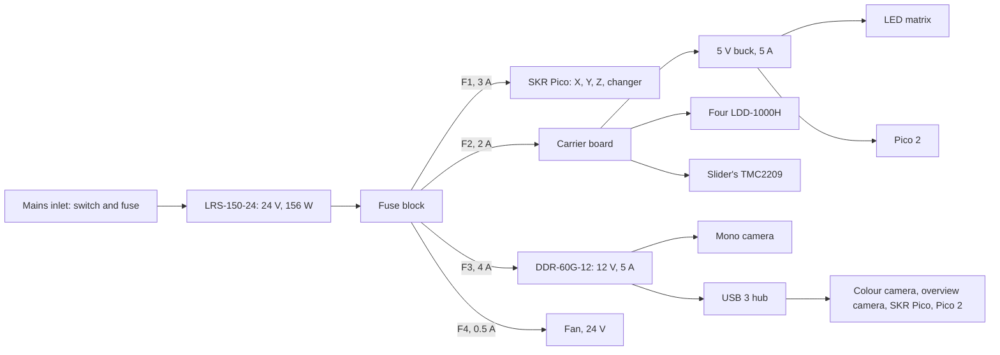
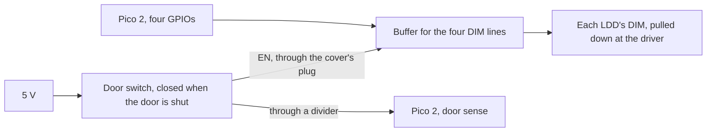

# OPTIMA electrical design

The power, the interlock, the grounding and each board's inputs and outputs, for phase E01 of the [electronics plan](optima_electronics_plan.md). The later phases build on it:

- E02 lists the cables;
- E03 sets up the motion controller;
- E04 and E05 design the carrier board;
- E06 and E07 write the firmware.

Started 2026-11-01. "Assumed" marks what a datasheet or the part in hand still has to confirm.

## 1. Decisions

| Decision | Choice | Why |
|---|---|---|
| 12 V for the mono camera | A 24-to-12 V converter on the tray, the Mean Well DDR-60G-12 (9–36 V in, 12 V at 5 A) | One mains inlet. It also feeds the USB hub. Plan decision 3, taken as recommended; the owner can still choose the camera's own adapter. |
| USB | A powered USB 3 hub on the tray, fed with 12 V, with one cable out to the PC | One cable through the cover's notch, which then lifts off without unplugging five. Plan decision 4, taken as recommended. |
| One carrier board | The Pico 2, the four LED drivers, the slider's TMC2209 and the 5 V buck share one board, which replaces the two carriers in the CAD | The LED drivers' enables never leave the board, which the interlock relies on (§4). One board to make and wire. |
| Fuses | One blade fuse per 24 V branch, in a fuse block on the tray | A fault in one branch can't take the others down, or set a thin wire alight |
| The board maker | JLCPCB, which also assembles the few surface-mount parts | Plan decision 2, the owner's |

## 2. The power tree

**The budget.** Peak means every load at once, which never happens in use: the steppers at full current, the matrix all white, an epi LED on, and the camera's TEC at full power.

| Load | Rail | Peak, W | In use, W | Source |
|---|---|---|---|---|
| X, Y and Z steppers, and the changer's | 24 V | 30 | 5 | The design's estimate; E03 sets the currents |
| The slider's stepper | 24 V | 3 | 0.5 | A NEMA 11 at about 0.5 A (assumed) |
| One epi LED, through its LDD-1000H | 24 V | 5 | 4 | 1 A at about 4 V, one LED at a time |
| The fan | 24 V | 3 | 3 | A 120 mm, 24 V fan (assumed) |
| The SKR Pico's logic | 24 V | 1 | 1 | Assumed |
| The LED matrix | 5 V | 19 | 3 | All 64 white at full brightness; patterns light a few |
| The Pico 2 and the carrier's logic | 5 V | 1 | 0.5 | Assumed |
| The mono camera, with its TEC | 12 V | 36 | 20 | The design's §8 |
| The USB hub and the bus-powered devices | 12 V | 8 | 5 | The colour camera about 5 W, the overview camera about 1.5 W (assumed) |

The 5 V rail peaks at 20 W: 22 W from 24 V at 90 % efficiency. The 12 V rail peaks at 44 W: 48 W from 24 V at 91 %. With the 42 W on 24 V directly, the supply gives at most about 112 W of its 156 W, and about 45 W in use. At about 90 % efficiency it draws up to 125 W from the mains: 0.55 A at 230 V, or 1.1 A at 115 V.

**The fuses.** A blade fuse per branch, 32 V rated, in a fuse block on the tray.

| Fuse | Branch | Peak current | Fuse |
|---|---|---|---|
| F1 | The SKR Pico | 1.3 A | 3 A |
| F2 | The carrier board: the LED drivers, the slider and the 5 V buck | 1.3 A | 2 A |
| F3 | The 12 V converter | 2.0 A, more at switch-on | 4 A |
| F4 | The fan | 0.15 A | 0.5 A |
| The inlet | The supply, from the mains | 0.55 A at 230 V | T2A at 230 V, T4A at 115 V |

The SKR Pico has its own fuse on the board too. The LRS-150-24 is set for 115 or 230 V by a switch, which has to match the mains before it's first switched on.

**The wires.**

| Run | Current | Wire |
|---|---|---|
| Mains, inlet to supply | Under 1.1 A | 0.75 mm², and 0.75 mm² green-and-yellow for the earth |
| 24 V, supply to fuse block | Up to 5 A | 1.0 mm² (about 17 AWG) |
| 24 V branches | Up to 4 A | 0.75 mm² (about 18 AWG) |
| 5 V to the matrix, on the moving lift | Up to 4 A | 0.75 mm², highly flexible: about 0.2 V drop over a 1 m cable, out and back |
| 12 V to the camera and the hub | Up to 4 A | 0.75 mm² |
| LED drivers to the epi LEDs | 1 A | 0.5 mm² (20 AWG), twisted pairs |
| Signals | Milliamps | 0.14 mm² (26 AWG): ribbon, or twisted pairs for the camera triggers |

E02 gives each cable its connectors and length.

## 3. Grounding

- **Protective earth** runs from the inlet to an earth stud on the base plate, its one star point. The supply's earth terminal, the column and the cover all have their own green-and-yellow wire to that stud. The cover's wire plugs in, so the cover still lifts off.
- **0 V.** The 24 V return meets the earth at that stud, and only there. The 5 V and 12 V returns join the 24 V return at their converters.
- **USB.** The cables' shields stay connected at both ends, as USB expects. The PC's own earth meets the instrument's through them, which is the usual arrangement.

The supply's mains terminals are covered, and the inlet's wiring carries sleeves over its crimps.

## 4. The interlock

The epi LEDs, about 1 W each and down to 395 nm, are an eye hazard through the optics (design §8). So the door's switch turns them off in the hardware, whatever the firmware does.

The LDD-H drivers turn off when DIM is below 0.8 V, measured from their negative input, and run when it's above 2.5 V, up to 6 V. They also run when DIM is left open. Hence the circuit:

1. **Pull-downs.** Each DIM line has a pull-down to the driver's negative input, right at the driver. A broken trace or wire then means off.
2. **The buffer.** A 5 V buffer drives the four DIM lines high, from four of the Pico's GPIOs. Its supply comes through the door's switch.
   - With the door open, or the cover off and its plug out, the buffer has no supply and every LED is off.
   - Its inputs are pulled down too, so the LEDs stay off while the Pico 2 starts up or resets.
3. **Door sense.** The firmware reads the switched supply, through a divider, so it knows the door is open. It refuses epi LED commands then, and says why.

The switch is the safety switch on the cover's front-right upright, which the shut door presses (CAD C07). E04 picks the buffer and its parts. The LED matrix isn't interlocked: its light is weak and white, and it shines up through the sample, not out of the instrument.

## 5. Inputs and outputs

### The motion controller: the SKR Pico with grblHAL

| Axis | Motor | Limits | Notes |
|---|---|---|---|
| X | The 8MTF-102LS05's X stepper | Both ends, wired to one input | Through its HDB15 connector (E02) |
| Y | Its Y stepper | Both ends, one input | The same |
| Z | The 8MVT100-25-1's stepper | Both ends, one input | The same |
| A | The changer's NEMA 11 | The home switch | Its carriage trips the switch (CAD C04) |

The SKR Pico has four TMC2209 drivers and four endstop inputs, one for each axis, which grblHAL can share between an axis's two ends. Above 0.8 A, its maker advises a fan on the drivers. E03 sets the currents from Standa's data, and adds a fan if they need one. The SKR Pico connects to the PC through the hub.

### The carrier board: the Pico 2

| Function | Pins | Direction | Notes |
|---|---|---|---|
| The epi LEDs' enables | 4 | Out | Through the interlock's buffer to each LDD-1000H's DIM (§4) |
| Door sense | 1 | In | The switched supply, through a divider |
| LED matrix | 2 | Out | SPI clock and data, through a 5 V buffer, such as a 74AHCT125, to the APA102s |
| Filter slider | 6 | Out, in | The TMC2209's step, direction, enable, its one-wire UART (two pins), and its diagnostic output |
| The slider's home switch | 1 | In | |
| Camera port | 2 | Out, in | The MFF102/M's two TTL lines: a pulse toggles it, and the other reports its position. The connector is to be confirmed from its manual. |
| Camera triggers | 2 | Out | One per camera, driving its trigger input (§6) |
| Exposure signals | 2 | In | One per camera, from its output (§6) |
| LED temperatures | 2 | I2C | Four thermistors on the LEDs' heatsinks, through an external ADC, since the Pico 2 has only three free ADC inputs |
| USB | | | To the PC, through the hub |

That's 22 of the Pico 2's 26 free GPIOs, with 4 to spare. E04 assigns the pins.

The carrier board also holds:
- the four LDD-1000H drivers, with an output to each epi LED;
- the 5 V buck, a module rated 5 A, for the matrix and the Pico 2;
- the TMC2209 StepStick for the slider;
- the connectors E02 lists.

### The cameras

| Camera | Power | Data | Trigger and exposure |
|---|---|---|---|
| Mono, CTR3CMOS45000KMA | 12 V, from the converter | USB 3, through the hub | An opto-isolated trigger input and an exposure output (assumed: ToupTek publishes no pinout) |
| Colour, E3ISPM45000KPB | USB | USB 3, through the hub | The same (assumed) |
| Overview | USB | USB 2, through the hub | None |

## 6. What's still open

- **The cameras' trigger connectors.** ToupTek doesn't publish the pinouts, so they wait for the cameras in hand or ToupTek's manual. Until then, the carrier gives each camera an open-collector trigger output that can drive 5–12 V at 10 mA, and an exposure input with a pull-up that takes an opto-isolated output. Both suit the usual opto-isolated interfaces.
- **The Standa stages' connectors.** Their HDB15 pinouts, the motors' currents and the limit switches' kind come from Standa's manuals, in E02 and E03.
- **The camera port's connector**, from the MFF102/M's manual.
- **The tray.** It needs room for the fuse block, the 12 V converter and the hub, while the one carrier board replaces the two. E02 updates its layout in the CAD.
