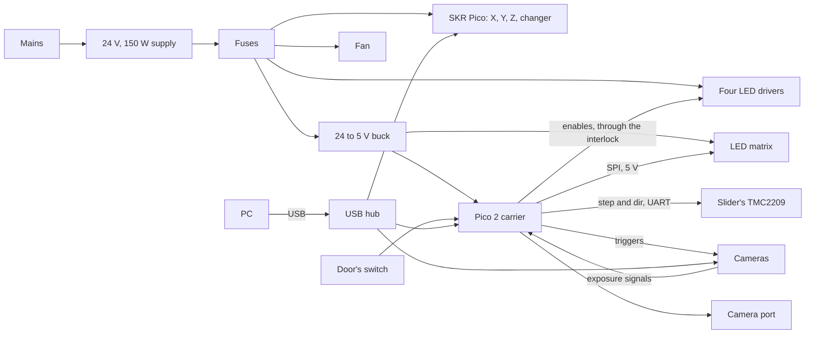

# OPTIMA electronics plan

How the electronics in the [OPTIMA hardware design](optima_hardware_design.md) become a wired, programmed instrument, in phases. It follows the [CAD plan](optima_cad_plan.md), whose models place every board, cable duct and connector this plan wires.

Started 2026-11-01.

## 1. Scope

Four areas, as the owner asked on 2026-11-01:

| Area | What it delivers |
|---|---|
| Wiring and power | The power tree and its fusing, the grounding, the interlock circuit, and every cable: its ends, conductors, connectors and length, the lengths taken from the CAD model |
| Motion controller | The SKR Pico running grblHAL: its pin map, the Standa stages' harnesses, the motor currents, limits and homing, and its settings |
| Optics carrier board | The board under the Pico 2: its schematic, its layout, and the files to have it made |
| Optics firmware | The Pico 2's firmware, written in Rust in this repository: LED channels, the matrix, the filter slider, the camera port, the camera triggers and preloaded sequences, over a documented serial protocol |

The server's drivers for these, in [design §10](optima_hardware_design.md#10-software-in-this-repository), aren't part of this plan. They follow the repository's milestone process, once the hardware they drive exists ([§7](#7-decisions-for-the-owner), decision 6).

## 2. Proposed decisions

These are proposals. The owner's decisions in [§7](#7-decisions-for-the-owner) can change them.

| Decision | Proposal |
|---|---|
| Source of truth | As in the CAD: scripts and text files in the repository build everything, and the built files are committed so they open without a build. The board's circuit is Python, and KiCad's command line checks it and makes its outputs. |
| Board tools | KiCad 9 for the schematic and the layout, with `kicad-cli` for the electrical rules check (ERC), the design rules check (DRC), PDFs, Gerbers and the assembly files. KiCad is GPL, but it's only a tool here: the files this project makes stay MIT. KiCad's symbol and footprint libraries are CC-BY-SA 4.0 with an exception for designs that use them. |
| The carrier board | Modules on headers wherever one exists: the Pico 2, a TMC2209 StepStick for the filter slider, and a 24-to-5 V buck module. That leaves a 2-layer board of mostly through-hole parts, which anyone can solder, and which any PCB maker can make. |
| Firmware | Rust with Embassy (MIT or Apache 2.0) on the RP2350, in its own Cargo workspace, `firmware/optics/`, with its own toolchain file. The server's workspace and its CI stay as they are, apart from one job that builds the firmware. |
| Firmware tests | The protocol, the sequencer and the interlock's logic in a `no_std` library, tested on the PC. What needs the board runs only when an environment variable names it, as the repository's hardware tests do. |
| The serial protocol | Line-based text over USB CDC, versioned, with its own document. It's this project's own design, written for this board. |
| grblHAL | GPL firmware, used as it is and not copied here. This project keeps only its settings and the notes for building and flashing it, as the design's §6.5 says. |
| Copying | As ADR-0002 asks: nothing copied from OpenFlexure, or from other projects' boards or firmware. Datasheets are read, and written up in this project's own words. |

## 3. The architecture

**Power.** One 24 V supply, the Mean Well LRS-150-24 on the electronics tray, from one mains inlet with a switch and a fuse. Its outputs go through a fuse each:

- the SKR Pico, which drives the four steppers;
- the four LED drivers;
- a 24-to-5 V buck for the LED matrix and the carrier board;
- the fan.

All 64 of the matrix's LEDs at full white draw about 19 W, almost 4 A at 5 V, so the buck needs 5 A. The mono camera's TEC needs 12 V. Either its own adapter feeds it, as the design's §8 says, or a 24-to-12 V converter on the tray does, for one mains inlet ([§7](#7-decisions-for-the-owner), decision 3).

**The interlock.** The door's switch is in series with the LED drivers' enables, so opening the door switches the drivers off without the firmware. The firmware reads the switch too, and refuses to light the epi LEDs while the door is open. Lifting the cover off unplugs the switch, which does the same. E01 picks the switch and its wiring, and E04 the circuit.

**Grounding.** The supply's protective earth goes to the base plate, and from it to the frame and the cover. The 24 V and 5 V returns meet the earth at one point, and the USB shields too.

**USB.** Five USB devices: the two ToupTek cameras, the overview camera, the SKR Pico and the Pico 2. A powered USB 3 hub on the tray, as the design's §13 lists, would leave one cable out of the cover ([§7](#7-decisions-for-the-owner), decision 4).

## 4. Phases

| Phase | Title | Size | What it adds |
|---|---|---|---|
| E01 | The electrical design | Docs | The power tree, with its budget, fuses and wire gauges. The interlock circuit. The grounding. Each board's I/O list. A design document with diagrams. |
| E02 | Cables | M | Every cable: its two ends, its conductors, connectors and length. The lengths come from the CAD model, by a script that follows the ducts. The Standa stages' HDB15 harnesses, from Standa's manuals. A cable list (CSV), and harness drawings as tables. |
| E03 | The motion controller | S | The SKR Pico's pin map for X, Y, Z and the changer. Steps per mm, speeds and accelerations, the TMC2209s' currents, limits, homing and soft limits. A grblHAL settings file, how to build and flash grblHAL for the SKR Pico, and a bench test. |
| E04 | The carrier board's schematic | M | The circuit in Python, its netlist and a KiCad schematic, with a clean ERC. The interlock, the LED drivers' enables, the slider's TMC2209, the matrix's level shifter, the camera triggers and exposure inputs, the camera port, the thermistors and the home switch. |
| E05 | The carrier board's layout | L | Placing the parts by script, routing, a clean DRC. The fabrication files (Gerbers, drills, bill of materials, placement) and a PDF of the board. |
| E06 | The optics firmware, part 1 | L | The firmware workspace and the CI job that builds it. The serial protocol and its document. The LED channels with the interlock, the camera triggers and exposure inputs, and their PC-side tests. |
| E07 | The optics firmware, part 2 | L | The LED matrix over SPI, the filter slider with homing, the camera port, and preloaded sequences stepped by the exposure signal. |
| E08 | Bench bring-up | M | Step-by-step tests for each board on the bench, and a small PC-side tool that speaks the protocol. The hardware tests, which run only when an environment variable names the board. |

E01 comes first, because every other phase builds on it. E02 and E03 can follow in either order. E04 and E05 come before E07, whose parts need the board to try on.

## 5. How work is delivered

As the CAD plan's §3 says, with these differences:

- **Branches and pull requests.** One branch, `optima/eNN-short-name`, and one pull request, `ENN: <title>`, per phase. The owner approves each before it's merged.
- **Size budget.** The size budget counts scripts and firmware, as the repository's rules say. Generated files and documents don't count.
- **Firmware.** Its phases follow the repository's code rules: formatting, Clippy and tests. Each new decision gets an ADR, such as the firmware's workspace, its use of `unsafe` (decision 5) and the protocol.
- **Done.** A phase is Done once the owner approves it. A phase whose parts need hardware, such as E03, E07 and E08, is Done only once the owner has run its bench test, as the repository's rule for drivers says.

## 6. Status

| Phase | Status |
|---|---|
| E01–E08 | Not started |

## 7. Decisions for the owner

1. **Board tools.** Install KiCad 9 and FreeRouting, the open router that KiCad uses, with the Java runtime FreeRouting needs. Or prefer a tool of your own. Needed by E04.
2. **Making the board.** Who makes it: JLCPCB, PCBWay or another maker. And whether you solder it yourself, or have the maker assemble the few surface-mount parts. Needed by E05.
3. **12 V for the mono camera.** Its own adapter, as the design says, or a 24-to-12 V converter on the tray, for one mains inlet. Needed by E01.
4. **USB.** A powered hub inside the cover, with one cable out, or five cables to the PC. Needed by E01.
5. **`unsafe` in the firmware.** The repository allows `unsafe` only in `microscope-sdk` (ADR-0041). Embassy keeps it out of most firmware, but a few places, such as the startup code and RP2350 registers no driver covers, may need it. Allow it in `firmware/optics/`, with a `SAFETY:` comment on each block. Needed by E06.
6. **The server's drivers.** The grblHAL, optics controller and ToupTek drivers from the design's §10 in a later milestone, once the boards work on the bench. Or in this track, after E08.
