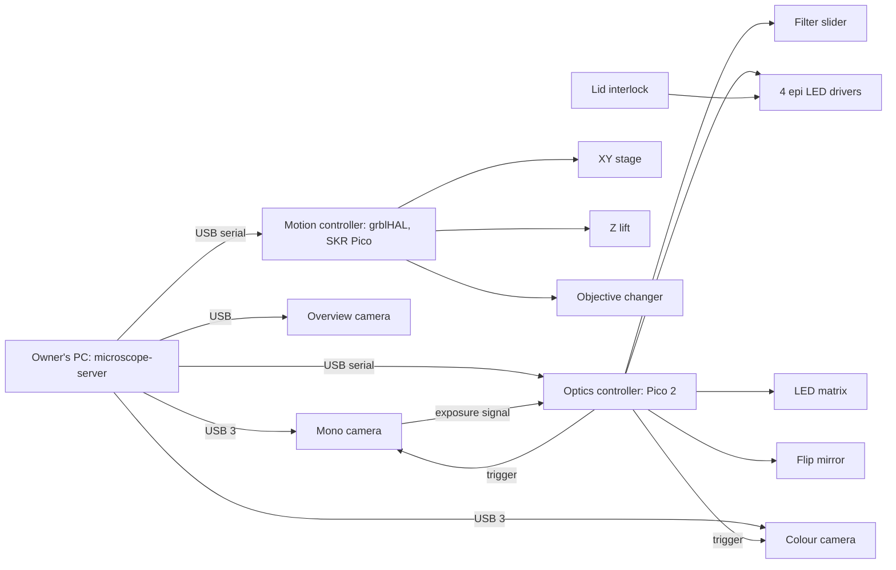

# OPTIMA upright microscope: hardware design

A design for a desktop, upright, automated microscope with the features in [OPTIMA](optima.md), built from off-the-shelf parts where possible.

Prepared 2026-10-31. Status: a proposal for the owner's review.

The owner set these constraints:

- Mitutoyo infinity-corrected, long-working-distance objectives.
- A low-cost, off-the-shelf tube lens.
- The ToupTek CTR3CMOS45000KMA camera.
- Upright geometry, for fixed samples only.
- 4-colour fluorescence and a second, colour camera.
- No Zaber stages.
- About $15k of hardware, not counting the objectives and the main camera.
- The owner's PC runs the server.

Prices marked *est.* are estimates. The others come from the sources in [§16](#16-sources), as found on 2026-10-31. Euro prices are converted at $1.10 per euro.

## Contents

1. [Summary](#1-summary)
2. [OPTIMA requirements and this design](#2-optima-requirements-and-this-design)
3. [Architecture](#3-architecture)
4. [Optics](#4-optics)
5. [Illumination](#5-illumination)
6. [Motion](#6-motion)
7. [Cameras and data](#7-cameras-and-data)
8. [Electronics, power and safety](#8-electronics-power-and-safety)
9. [Mechanical layout](#9-mechanical-layout)
10. [Software in this repository](#10-software-in-this-repository)
11. [Calibration and acceptance tests](#11-calibration-and-acceptance-tests)
12. [Risks](#12-risks)
13. [Bill of materials and budget](#13-bill-of-materials-and-budget)
14. [Decisions for the owner](#14-decisions-for-the-owner)
15. [Build order](#15-build-order)
16. [Sources](#16-sources)

## 1. Summary

The sample sits on an open-frame XY stage, which rides on a Z lift. An 8 × 8 RGB LED matrix sits below the sample and gives brightfield, colour brightfield, DPC, oblique and darkfield illumination. Above the sample, a three-position linear changer holds the Mitutoyo 5x, 10x and 20x objectives. Above that, a three-position filter slider selects a quad-band fluorescence cube, an open position for transmitted light, or a beamsplitter for reflected light. Four LEDs light the fluorescence cube through a Köhler epi-illuminator. A 200 mm tube lens forms the image, and two mirrors fold it sideways to the cameras. A flip mirror sends it either to the mono ToupTek camera or to a colour camera. A small USB camera gives an overview of the stage.

| Area | Choice |
|---|---|
| Geometry | Upright. The optics stay fixed, and the stage moves in X, Y and Z. |
| Objectives | Mitutoyo M Plan Apo 5x/0.14, 10x/0.28 and 20x/0.42 on a motorized three-position linear changer |
| Tube lens | Thorlabs TTL200-A, f = 200 mm, $572.99 |
| Cameras | ToupTek CTR3CMOS45000KMA, mono, for fluorescence and DPC. An IMX492 colour camera on a switched side port. A USB overview camera. |
| Transmitted light | Adafruit DotStar 8 × 8 RGB matrix (APA102, 5 mm pitch), about 40 mm below the sample |
| Epi light | LEDs at about 395, 470, 565 and 625 nm, combined with dichroics. Chroma 89402 multi-LED quad filter set. |
| XY stage | Standa 8MTF-102LS05: 102 × 102 mm travel, open frame |
| Focus | Standa 8MVT100-25-1 lift under the XY stage: 25 mm travel |
| Controllers | grblHAL on a BTT SKR Pico for X, Y, Z and the objective changer. A Raspberry Pi Pico 2 with this project's firmware for the light path and the camera triggers. |
| Cost | About $18.0k as specified. About $14.9k with three substitutions ([§13](#13-bill-of-materials-and-budget)). |

## 2. OPTIMA requirements and this design

| OPTIMA feature | This design | Status |
|---|---|---|
| Objectives 4x/10x/20x/40x | Mitutoyo 5x/10x/20x. A 50x (NA 0.55, WD 13 mm) can take one position later. | Partly: Mitutoyo's M Plan Apo line has no 4x or 40x. |
| Motorized three-position turret | A three-position linear changer ([§6.3](#63-objective-changer)) | Met |
| Excitation at 405/488/635 nm, with 1, 2 or 4 lasers | Four LEDs matched to the filter set's 391/32, 479/33, 554/24 and 638/31 nm bands ([§5.2](#52-epi-fluorescence)) | Met, with LEDs instead of lasers |
| Emission bands and a custom cube | A quad-band emitter in a switched cube. Single-band cubes fit the same slider. | Met |
| Brightfield, coloured brightfield | The LED matrix: the mono camera with red, green and blue frames, or the colour camera | Met |
| Phase contrast | DPC and oblique illumination. Zernike phase contrast needs phase objectives, which Mitutoyo doesn't make. | Partly |
| Fluorescence | Four channels | Met |
| DPC | Four half-disk patterns on the matrix | Met |
| FLIM (FLIM Labs) | Not in this build | Deferred ([§14](#14-decisions-for-the-owner)) |
| XYZ range 100 × 100 × 20 mm | 102 × 102 × 25 mm | Met |
| Focus drive Zf 4 mm | The same 25 mm Z axis, in 0.16 µm microsteps | Met by one axis |
| LED array for phase contrast | Yes | Met |
| Labware | Slides (four), counting chambers, dishes, plates and flasks, on 160 × 110 mm inserts. An upright limits liquid-filled vessels to low NA ([§4.5](#45-what-an-upright-can-image)). | Partly |
| Single or dual camera | Mono and colour cameras on a switched port. They can't record at the same time. | Partly. Simultaneous imaging needs a beamsplitter in place of the flip mirror. |
| Overview camera, top | A USB camera beside the objectives | Met |
| Data formats | Software in this repository. Data rates are in [§7](#7-cameras-and-data). | Not hardware |
| 300 × 300 × 300 mm, under 16 kg | About 450 × 400 × 430 mm and 18 kg | Not met ([§9](#9-mechanical-layout)) |
| 110/230 V; 12 V 5 A; battery | Mains to one 24 V 150 W supply. The peak draw, about 90–100 W, is above 12 V 5 A. | Partly |

## 3. Architecture

### Light path (side view, schematic)

```text
   mono camera ◄─── flip mirror ◄─────── fold mirror (45°)
                        │  (in: to the            ▲
                        ▼   colour camera)        │  converging light, 151.8 mm
                  colour camera                   │
                                         tube lens TTL200-A, f = 200 mm
                                                  ▲
                                                  │  infinity space: keep it ≤ ~75 mm
  4 LEDs ─► collectors ─► dichroic ─► field ─► epi ─┤
                          combiner    stop     lens │  filter slider:
                                                    │  [quad cube | open | 50:50]
                                                  ▲
                                       objective changer [5x | 10x | 20x]
                                                  ▲
                                      ══════════ sample ══════════
                                      XY stage, 102 × 102 mm, open frame
                                                  ▲
                                     8 × 8 LED matrix, about 40 mm below the sample
                                     Z lift (25 mm) under the stage and the matrix
                                     ─────────────── base plate ───────────────
```

Fluorescence travels up through the objective, the quad cube and the tube lens. Excitation light enters the cube from the side and the dichroic sends it down through the objective. Transmitted light comes up from the matrix. Both mirrors sit in the converging light after the tube lens, where a plane mirror adds no aberrations.

### Control



## 4. Optics

### 4.1 Objectives

| | 5x | 10x | 20x |
|---|---|---|---|
| Mitutoyo part | 378-802-6 (renumbered 378-802-12) | 378-803-3 | 378-804-3 |
| NA | 0.14 | 0.28 | 0.42 |
| Working distance | 34.0 mm | 34.0 mm | 20.0 mm |
| Focal length | 40 mm | 20 mm | 10 mm |
| Back aperture, 2·NA·f | 11.2 mm | 11.2 mm | 8.4 mm |
| Depth of field (Mitutoyo) | 14 µm | 3.5 µm | 1.6 µm |
| Resolution, 0.61λ/NA at 520 nm | 2.27 µm | 1.13 µm | 0.76 µm |

- **Mounting.** The thread is M26 × 0.706. The parfocal length is 95 mm, so all three focus at the same height, and the barrels are about 34 mm across. Check both against Mitutoyo's drawings before machining.
- **No cover glass correction.** They're corrected for no cover glass (∞/0). [§4.5](#45-what-an-upright-can-image) gives what that costs.
- **Visible light only.** Edmund lists 435–655 nm for the M Plan Apo HR series, and the standard series' transmission curve starts near 400 nm. Two consequences:
  - The DAPI excitation at about 395 nm goes through glass that wasn't designed for it, so expect a weaker DAPI channel and check the objectives' autofluorescence ([§11](#11-calibration-and-acceptance-tests)).
  - Cy5 emission extends past 655 nm, so that channel needs its own focus offset.

### 4.2 Tube lens and infinity space

The recommended tube lens is the **Thorlabs TTL200-A**: $572.99, f = 200 mm, a Ø22 mm field, a Ø20 mm entrance pupil, 151.8 mm from the lens to the image, SM2 threads, AR-coated for 350–700 nm. Thorlabs lists Mitutoyo among the objectives it matches.

Two numbers matter with a 22.96 mm sensor diagonal.

**Field.** The sensor's diagonal is 0.96 mm larger than the lens's rated Ø22 mm field. Only the four extreme corners, about 0.4 % of the sensor's area, fall outside it.

**Vignetting.** Light for the image corner leaves the objective at an angle θ = (sensor diagonal / 2) / f_TL = 3.3°. Over a distance L from the objective's exit pupil, that bundle moves off-axis by L·tan θ. The tube lens's pupil stops clipping the corners only while

```text
L ≤ (D_tube − D_objective) × f_tube / sensor diagonal
  = (D_tube − D_objective) × 200 / 22.96
```

| Tube lens | Entrance pupil | L for 5x, 10x | L for 20x | Price |
|---|---|---|---|---|
| Thorlabs TTL200-A (recommended) | Ø20 mm | 77 mm | 101 mm | $572.99 |
| Mitutoyo MT-1 | Ø24 mm (Edmund's example), Ø30 mm field | 111 mm | 136 mm | $950 |
| Ø2 in. achromat, Thorlabs AC508-200-A | about Ø45 mm clear (*est.*) | about 290 mm | about 320 mm | about $150 (*est.*) |

The design rule follows: **keep the infinity space short.** The objective changer, the filter slider and then the tube lens come directly one after another, with nothing else in between. All folding happens after the tube lens. The target is L ≈ 70 mm.

Mitutoyo doesn't publish how deep the exit pupil sits inside the objective, so measure the corner falloff on a bench before building the head (build step 1, [§15](#15-build-order)).

- **If the corners lose more than about 20 %:** change to the MT-1.
- **The achromat** never vignettes, but a single cemented doublet has more field curvature and astigmatism at the corners. It suits 5x and 10x previews, not stitched scans.

Adding anything to the infinity space later lengthens L. That includes a laser-autofocus dichroic, and it's a reason to move to the MT-1.

### 4.3 Camera ports

The 151.8 mm of converging light after the tube lens holds two mirrors:

- **A fixed fold mirror,** about 35 mm after the lens, turns the path horizontal.
- **A motorized flip mirror (Thorlabs MFF102/M),** about 50 mm further on, sends the light to the colour camera when it's in.

Each camera's sensor sits about 65 mm past the flip mirror, which keeps the two 80 mm camera bodies clear of each other.

- **Mirror size.** At both mirrors the beam is no more than about 21 mm across, about 30 mm long on a 45° mirror. 2 in. mirrors leave room for alignment.
- **Parfocal adjustment.** Set each camera's distance with SM2 lens tubes and C-mount spacers so both cameras focus together.
- **Repeatability.** The flip mirror's repeatability moves only the colour image, and a calibrated offset corrects it.
- **Simultaneous dual camera, later.** Replace the flip mirror with a beamsplitter. In converging light, use a cube or a thin plate (1 mm or less), since a thick 45° plate adds astigmatism.

### 4.4 Sampling and field

The sensor is 8176 × 5616 pixels of 2.315 µm, an 18.93 × 13.00 mm area.

| Objective | Pixel at the sample | With 2×2 binning | Nyquist limit, λ/(4·NA) at 520 nm | Field of view |
|---|---|---|---|---|
| 5x | 0.463 µm | 0.926 µm | 0.93 µm | 3.79 × 2.60 mm |
| 10x | 0.232 µm | 0.463 µm | 0.46 µm | 1.89 × 1.30 mm |
| 20x | 0.116 µm | 0.232 µm | 0.31 µm | 0.95 × 0.65 mm |

- **Binning.** With 2×2 binning, 5x and 10x sample at the Nyquist limit and 20x slightly better than it. Use it for fluorescence and DPC: it collects four times the light per pixel and quarters the data.
- **Native pixels** give no extra resolution with these objectives.
- **The colour camera's Bayer pattern** samples each colour at 4.63 µm, about the Nyquist limit at 10x.

### 4.5 What an upright can image

Three effects limit an upright with dry, uncorrected objectives. Each is estimated from the primary spherical aberration of a flat layer (thickness t, index n) or from the well's geometry.

| Sample | 5x (0.14) | 10x (0.28) | 20x (0.42) |
|---|---|---|---|
| Slide with a 0.17 mm cover glass | Fine | Fine | Fine: Strehl ratio about 0.95 |
| Counting chamber, 0.4 mm cover glass | Fine | Fine | Slightly soft: about 0.08 waves RMS |
| Cells under 1 mm of liquid | Fine | Fine: about 0.04 waves RMS | Poor: about 0.18 waves RMS |
| Cells under 3 mm of liquid (a 96-well with medium) | Fine | Soft: Strehl ratio about 0.6 | Unusable |
| Through a 1 mm plastic wall (a flask, from above) | Fine | Fine | Poor |
| Well-wall clipping, 96-well (Ø6.4 mm, about 10.7 mm deep) | None | The cone just fits at the field centre | Effective NA limited to about 0.29 |
| Well-wall clipping, 384-well (Ø3.4 mm, about 11.5 mm deep) | Borderline | Effective NA about 0.15 | Effective NA about 0.15 |

The practical rules follow from the table:

- **Slides, sections, smears and counting chambers:** all three objectives.
- **Plates and dishes with medium:** 5x, and 10x with 1 mm or less of liquid over the cells. 20x only on dry or mounted samples. The meniscus also bends transmitted light near the well walls.
- **Flasks:** 5x and 10x.

Upright microscopes usually image liquid samples with water-dipping objectives. Mitutoyo doesn't make them, so they're outside this design.

## 5. Illumination

### 5.1 Transmitted light: the LED matrix

**The part.** An [Adafruit 2734](https://www.adafruit.com/product/2734) flexible DotStar matrix: 8 × 8 RGB LEDs with APA102 drivers at a 5 mm pitch, about 40 mm square. The optics controller drives it over SPI.

**Why APA102.** The APA102 drives every LED continuously. Row-multiplexed panels (HUB75) flicker and put bands across a rolling-shutter image, so avoid them.

**Driving rule.** Drive each LED fully on or fully off, and set the dose with exposure time. Never dim it with PWM during an exposure.

**Position.** Centre the matrix on the optical axis, about 40 mm below the sample. It mounts on a post from the Z-lift plate up into the stage's opening. Standa's drawing gives the opening as □64–115 mm depending on the stage's position, so the 45 mm board fits throughout the travel. Every ray from the matrix to the field stays within 25 mm of the axis.

At 40 mm, the LEDs fall into these illumination NAs (the grid has no LED on the axis):

| Objective | LEDs inside the objective's NA (brightfield, DPC) | LEDs outside it (darkfield) |
|---|---|---|
| 5x, NA 0.14 | The centre 2 × 2, at NA 0.09 | The other 60, at NA 0.19–0.53 |
| 10x, NA 0.28 | The centre 4 × 4, up to NA 0.26 | The outer ring, at NA 0.30–0.53 |
| 20x, NA 0.42 | 44 LEDs, up to NA 0.41 | 20 corner LEDs, at NA 0.43–0.53: weak darkfield |

The matrix supports these modes:

- **Brightfield:** a disk of LEDs inside the objective's NA.
- **Colour brightfield:** red, green and blue frames on the mono camera, which gives full-resolution colour; or a white disk on the colour camera, which gives live colour.
- **DPC:** four half-disks (top, bottom, left, right), green, mono camera. Quantitative phase follows Tian and Waller (2015).
- **Oblique illumination and darkfield,** including coloured darkfield (Rheinberg-style) on the colour camera.
- **Single-LED angle scans,** for Fourier ptychography later.

DPC and angle scans need each LED's position relative to the axis, which is calibrated from brightfield-to-darkfield transitions ([§11](#11-calibration-and-acceptance-tests)). At 5x the 5 mm pitch is coarse: brightfield and each DPC half use only two to four LEDs. A custom 32 × 32 board of APA102-2020 LEDs at 2.5 mm pitch is the upgrade if that proves limiting.

### 5.2 Epi-fluorescence

**Filter set.** Chroma **89402** (ET multi-LED quad set) costs $1,550: exciter $575, dichroic $500, emitter $600. It's designed for multi-LED light engines.

| Channel | Excitation band | LED | Typical dyes |
|---|---|---|---|
| 1 | 391/32 nm | About 395 nm | DAPI, Hoechst, Alexa Fluor 405 |
| 2 | 479/33 nm | 470 nm (Thorlabs M470L5) | GFP, FITC, Alexa Fluor 488 |
| 3 | 554/24 nm | 565 nm lime, broadband phosphor (Thorlabs M565L3) | TRITC, Alexa Fluor 555/568. It excites mCherry at about half its peak. |
| 4 | 638/31 nm | 625 nm (Thorlabs M625L4). It fills the upper half of the band; a 635–640 nm LED would fill more. | Cy5, Alexa Fluor 647 |

For comparison, Semrock's DA/FI/TR/Cy5-4X-B quad set is listed at $3,287.59.

**LED combiner.** Long-pass dichroics in 30 mm cage cubes join the four LEDs, working back from the far end:

1. The 625 nm LED sits on the axis.
2. A DMLP605 reflects the 565 nm LED in.
3. A DMLP505 reflects the 470 nm LED in.
4. A DMLP425 reflects the 395 nm LED in.

The lime LED's light above 605 nm is lost at the first dichroic, and its exciter band discards it anyway.

**Köhler epi-illuminator.**

- **Collectors.** Each LED has an f = 20 mm aspheric collector, which sends its image to infinity.
- **Field stop and epi lens.** After the combiner, an iris field stop sits at the front focal plane of an f = 125 mm achromat. That achromat sits about 125 mm from the objective's back aperture.
- **Result.** The LED's image falls in the objective's back aperture, about 6 mm across for a 1 mm die, and the field stop images onto the sample. The field stop's image and the camera's field both scale with the objective's focal length, so one stop size fits all three objectives: 22.96 mm × 125 / 200 = **14.4 mm**.

**Exciter placement.** The exciter sits in the cube, at slider position (a), not after the combiner. The open and beamsplitter positions then get unfiltered LED light.

**Drivers.** Four Mean Well LDD-H constant-current drivers, set to each LED's rated current and switched on or off through their DIM pins.

- **No PWM dimming.** Their PWM dimming (100 Hz–1 kHz) would put bands across a rolling-shutter image, so it isn't used. Exposure time sets the dose.
- **Analog intensity.** For that, use drivers with analog current control, such as Thorlabs LEDD1B (*est.* $1.4k for four), or a linear driver on a later optics-controller board.
- **Availability.** One distributor lists the LDD-H series as discontinued, so check stock first.

**Crosstalk.** The quad emitter passes all four bands at once. Exciting one LED at a time separates the channels, but some crosstalk remains, such as GFP's tail in the TRITC band, and it must be measured ([§11](#11-calibration-and-acceptance-tests)). Single-band cubes lower crosstalk, at the cost of slider positions.

### 5.3 Reflected brightfield

Slider position (c) holds a 50:50 plate beamsplitter. With no exciter in that position, the four LEDs on together give a broad light, suitable for opaque samples: wafers, PCBs, metal. The colour camera's white balance corrects its tint. For accurate colour, such as metallography, add a white LED as a fifth combiner arm later.

### 5.4 Timing with a rolling shutter

The ToupTek cameras use rolling shutters. Each row starts its exposure a little after the one before. At full frame, the frame period is about 123 ms (8.1 fps), and in the 4080 × 2808 mode about 33 ms (30 fps). These bound the readout time; measure the actual line time.

These rules follow from the rolling shutter:

- **Constant light per frame.** The light must stay constant from the first row's start to the last row's end: the exposure plus the readout. Never change an LED, a matrix pattern or a filter position inside that window, and never dim with PWM.
- **Still stage.** The stage must be stopped and settled for the same window.
- **Switch between frames.** The optics controller switches the light on the camera's exposure signal. It can also step through a preloaded sequence of light states, such as four fluorescence channels or four DPC patterns, one per frame, with no round trip to the PC between frames.
- **The longer illumination doesn't matter here.** Lighting the sample through the readout as well as the exposure adds light dose, which doesn't matter for fixed samples. A strobe confined to the window when every row is exposing is possible only when the exposure is longer than the readout.

## 6. Motion

Zaber stages were excluded at the owner's request.

### 6.1 XY stage

| Stage | Travel | Open frame | Drive | Price | Notes |
|---|---|---|---|---|---|
| **Standa 8MTF-102LS05** (recommended) | 102 × 102 mm | Yes: a 115 mm opening in the top plate, □64–115 mm through the stack | 0.5 mm lead screw, 2-phase stepper. 2.5 µm full step, 0.31 µm at 1/8 step. 10 mm/s. 50 kg horizontal load. | Quote needed, *est.* €3–4.5k | 214 mm square (276.5 mm with motors), 45 mm high, 3.6 kg. Limit switches. Accepts linear encoders. |
| Standa 8MTF-200 | 200 × 200 mm | Yes: 205 × 205 mm | 2 mm ball screw, stepper or BLDC. ±0.5 µm unidirectional repeatability. 30–50 mm/s. | Quote needed | Too large for a desktop: 402 × 450 mm |
| Prior ProScan H101 (upright) | 114 × 75 mm | Yes | Stepper, with the ProScan controller | $11,375 (H101P1F) | A premium option, over budget |
| OptoSigma BIOS-105S (upright) | Not checked | Yes | Stage, controller and joystick | SGD 15,854 | Over budget |
| Two industrial linear modules, such as HIWIN KK40, 1 mm lead | 100 mm each | No: the sample sits on a cantilever arm | ±10 µm repeatability (catalogue) | *est.* $0.6–1.2k plus motors | The cheapest option. It needs a stiff arm over the LED matrix. |
| A used Prior, Märzhäuser or Ludl stage with its controller | About 110 × 75 mm | Yes | Stepper | *est.* $1–3k | Good value if a tested unit turns up. Needs a driver for its protocol. |

The Standa 8MTF-102LS05 is the only mid-priced, microscope-ready open frame found.

- **Travel.** Its 102 mm covers a 96-well plate's 99 mm span of well centres. A 384-well plate's centres span 103.5 mm, so the outermost columns are imaged near the edge of the field.
- **Speed is the compromise.** At 10 mm/s, a crossing of the plate takes about 10 s and a 1.7 mm tile step about 0.3 s.
- **Mounting.** The top plate has M3 and M6 holes on a 25 mm grid and a 4 mm-deep recess around the opening, which take the sample-insert adapter ([§9](#9-mechanical-layout)).

### 6.2 Focus

The **Standa 8MVT100-25-1** lift sits under the XY stage and the LED matrix.

| Property | Value |
|---|---|
| Travel | 25 mm |
| Lead screw | 1 mm |
| Resolution | 5 µm full step; 0.625 µm at 1/8 step; 0.16 µm at 1/32 step with a TMC2209 |
| Speed | 20 mm/s |
| Load | 8 kg |
| Repeatability | 1 µm unidirectional, 2 µm bidirectional |
| Weight | 2.2 kg |

It moves about 5 kg: the XY stage, the matrix, the insert and the sample.

**Why the stage moves rather than the objectives:**

- The optics stay fixed, so the infinity-space length L ([§4.2](#42-tube-lens-and-infinity-space)) never changes.
- The alignment stays stable, and the cables to the head never flex.
- The lift carries a centred load, as it's designed to.
- The matrix moves with the sample, so the illumination angles don't change with focus.

**What it costs:**

- Longer settling for each focus step.
- The lift's pitch error shifts XY slightly with Z, which calibration corrects.

**The alternative.** A vertical stage on the column could move the objective changer, about 1.5 kg, which is faster. That changes L by up to the focus travel.

**Steps.** The 20x's 1.6 µm depth of field is well served by 0.16 µm microsteps. Use 0.4–0.8 µm steps for 20x z-stacks.

### 6.3 Objective changer

No motorized three-position changer for M26 objectives fits the budget. OptoSigma's LACS-2H-A holds only two, for about $2.2k, and Mitutoyo's motorized turret is part of its video microscope unit, at $5,990.

**Build a linear slider instead:**

- **Carriage.** The three objectives sit 40 mm apart on a machined aluminium carriage. Tap it M26 × 0.706, or use M26-to-SM1/SM2 adapters.
- **Guide and drive.** The carriage runs on a miniature linear guide (MGN12, 120 mm rail) and is driven by a NEMA 11 lead-screw stepper with a home switch.
- **Detents.** A spring-loaded ball-and-V detent locates each position, so repeatability doesn't depend on the motor. Lower the stepper's holding current at a detent so the two don't fight.
- **Expected offsets.** After a change, expect the image to move a few micrometres. Per-objective offsets and image registration correct it.

**Collision.** The 20x's front lens sits 14 mm lower than the 5x's and the 10x's (WD 20 vs 34 mm), and every objective sweeps over the sample during a change. Before a change, the server must lower the stage until the lowest front lens clears the sample's top, which it knows from the labware definition.

### 6.4 Filter slider

The slider has three positions, moving front to back, perpendicular to the epi arm:

- **(a)** the quad cube: exciter, dichroic at 45°, emitter;
- **(b)** open;
- **(c)** a 50:50 plate.

It uses the same guide-and-stepper construction as the objective changer.

**Precision barely matters.** The filters are 25 mm across and the beam about 18 mm. A tilted parallel plate in the infinity space only shifts the beam sideways, and a sideways shift doesn't move the image. So the slider's repeatability hardly affects the image; only a wedge in a filter would, slightly.

### 6.5 Motion and optics controllers

**Motion controller.** A BTT SKR Pico (RP2040, four TMC2209 drivers on the board) running **grblHAL**, which lists the SKR Pico as a supported four-axis board.

| Topic | Detail |
|---|---|
| Axes | X, Y, Z and A, the objective changer |
| Wiring | The Standa stages connect through their HDB15 connectors (motor and limit switches) via adapter harnesses |
| Firmware features | Acceleration, homing, limits and backlash compensation, all built in |
| Protocol | G-code plus documented real-time status commands, over USB serial |
| Licence | grblHAL is GPL-licensed. It runs on its own board, and this project's MIT software only talks to it over serial; nothing is linked or redistributed. |

The alternative is Standa's own 8SMC5 controllers: €1,387 for two axes and €685 for one, or €2,158 for a three-axis unit. They're supported by the vendor, ready for encoders, and offer 1/256 microstepping and synchronization I/O, at about $2.3k more.

**Optics controller.** A Raspberry Pi Pico 2 (RP2350) on a small carrier board, running this project's firmware: Rust, MIT, kept in this repository. It owns the light path and its timing:

- the four LED-driver enables, wired through the lid interlock;
- the LED matrix, over SPI through a 5 V level shifter;
- the filter slider's stepper (a TMC2209) and home switch;
- the flip mirror, through its digital input (SMA);
- a trigger output to each camera's opto-isolated input, and the cameras' exposure outputs;
- the lid interlock and the LED heatsink thermistors.

It speaks a line-based protocol over USB serial and can run preloaded sequences ([§5.4](#54-timing-with-a-rolling-shutter)).

It's custom because no off-the-shelf box does matrix patterns, LED channels and camera triggers at this price. Owning the firmware also keeps the timing deterministic.

## 7. Cameras and data

### Mono camera: ToupTek CTR3CMOS45000KMA

| Property | Value (ToupTek) |
|---|---|
| Sensor | Sony IMX492, mono, rolling shutter |
| Pixels | 8176 × 5616 at 2.315 µm. 18.93 × 13.00 mm active area, 22.96 mm diagonal. |
| Frame rates | 8.1 fps at full frame, 30 fps at 4080 × 2808, 86.5 fps at 1360 × 720. ToupTek doesn't say which modes bin. |
| Bit depth | 8 or 12 bits |
| Exposure | 0.1 ms to 300 s |
| Cooling | TEC, closed loop. ToupTek gives conflicting figures: ΔT of 5–10 °C, 20 °C and 42 °C below ambient. |
| Interface, I/O | USB 3.0. Isolated trigger input and output, plus two GPIO. |
| Mount, size | C-mount. 80 × 80 × 45.5 mm, 396.6 g. |
| Power | USB, or 12 V (3 A adapter supplied) |
| Not published | Full-well capacity, read noise ("down to 1 e⁻" for the series), QE. Measure them ([§11](#11-calibration-and-acceptance-tests)). |

**SDK.**

- ToupTek's SDK is a closed-source C library for Windows, Linux, macOS and Android.
- ToupTek doesn't confirm Linux ARM64 (third-party drivers report it), which doesn't matter with a PC host.
- The user installs the SDK; this project never redistributes it.

### Colour camera

The owner chose a colour IMX492, the same sensor as the mono camera.

**The options:**

- **ToupTek's colour twin** of the mono camera is the CTR3CMOS45000KPA, which is cooled; no price was found.
- **The uncooled ToupCam E3ISPM 45000** (colour IMX492, 2.315 µm, 8.1 fps, USB 3.0) sells for about **$2,174** (€1,790 at one retailer).
- **Price correction.** That is more than the $700–1,200 estimated when the colour camera was chosen.

**The cheaper alternative** is a ToupTek colour IMX294 camera, at about $800–1,100. The IMX294 has the same 4/3-inch format with 4.63 µm pixels, so its field is about the same; check its active area.

- **Trade-off.** Its Bayer pattern samples each colour at 9.26 µm, which undersamples colour detail at 10x by about two times.
- **Why that's acceptable.** Full-resolution colour still comes from the mono camera with red, green and blue frames. The colour camera's job is live colour and quick colour scans.

This is decision 1 in [§14](#14-decisions-for-the-owner).

### Overview camera

A 12 MP USB (UVC) camera module with a wide M12 lens, *est.* $100–150.

- **Mounting.** At the front of the head, tilted toward the centre of the stage.
- **Calibration.** A calibrated homography maps its pixels to stage coordinates.
- **Lighting.** It uses the LED matrix, plus a small white LED ring for opaque samples.
- **Uses.** Finding labware and samples, and a navigation map in the web app.
- **Why it sits at an angle.** The stage's ±51 mm travel can't bring a whole plate under a camera placed beside the objectives, so it looks at the stage from there.

### Data

| Frame | Size |
|---|---|
| Full frame, 8-bit | 45.9 MB |
| Full frame, 12-bit stored in 16 | 91.8 MB |
| 2×2 binned, 16-bit | 23.0 MB |

- **Peak rate.** At full frame and 8.1 fps, 8-bit, the camera sends about 372 MB/s, close to USB 3.0's practical limit.
- **One camera at a time.** Only one 45 MP camera streams at a time. If the PC has two USB controllers, give each camera its own.
- **Storage.** Use a disk that sustains at least 400 MB/s, and OME-Zarr with chunked, compressed storage.

Two illustrative 96-well scans, assuming 10 % tile overlap, wells 6.4 mm across, exposures of about 100 ms and the stage at 10 mm/s:

| Scan | Positions | Frames | Data | Time |
|---|---|---|---|---|
| 5x brightfield overview of every well, binned | 576 (6 per well) | 576 | about 13 GB | about 10 min |
| 10x, 4 fluorescence channels, binned | 2,304 (24 per well) | 9,216 | about 212 GB | about 40 min, plus focus |

## 8. Electronics, power and safety

| Load | Supply | Peak |
|---|---|---|
| Mono camera with TEC | 12 V, its own 3 A adapter | 36 W or less |
| Colour camera, uncooled | USB | about 3–5 W (*est.*) |
| Five steppers: XYZ, objective changer, filter slider | 24 V | about 30 W (*est.*) |
| One epi LED at a time, 1 A or less at about 4 V | 24 V through an LDD-H | about 5 W |
| LED matrix, all 64 white | 5 V from 24 V | about 19 W. Patterns use far less. |
| Controllers, overview camera | USB, 5 V | about 3 W |
| **Total** | | **about 90–100 W peak, about 40 W typical** |

- **Mains.** One 24 V, 150 W supply from the mains, plus the camera's 12 V adapter. A 24-to-12 V converter would give the instrument a single inlet.
- **12 V input.** OPTIMA's 12 V 5 A (60 W) input would work only with the TEC limited. Battery power isn't part of this build.
- **Eye safety.** The 395 nm and the visible epi LEDs, about 1 W each, are an eye hazard when viewed through the optics. The enclosure is light-tight. A lid interlock switches off the LED-driver enables in hardware, not only in firmware. Using LEDs avoids laser classification altogether.
- **Cables.** Flexible, strain-relieved cables to the moving stage. One ground point for the frame, the supplies and the USB shields.

## 9. Mechanical layout

**Base.** A 10–12 mm aluminium plate, about 450 × 400 mm, on vibration-damping feet.

**Z assembly.** The Z lift sits at the centre-front of the base. It carries a 12–15 mm aluminium plate, which holds two things:

- the LED matrix, on a post that reaches into the stage's opening;
- the XY stage, on four spacers.

**Column and head.** A ribbed aluminium plate or a pair of 40 × 80 mm extrusions stands at the back. It carries the optical head, from the bottom up:

1. the objective changer, at a fixed height;
2. the filter slider, with the epi arm on a 30 mm cage to the right;
3. the tube lens, in a 60 mm cage (SM2 threads);
4. the fold mirror and the flip mirror;
5. the cameras, horizontal at the top, facing back and left.

**Sample inserts.** An aluminium adapter on the stage's top plate takes 160 × 110 mm inserts: a microplate holder, a four-slide holder, 35 and 60 mm dishes, and a counting chamber. Several stage makers use that insert size; confirm it against the inserts you buy.

**Enclosure.** Black-anodized panels on an extrusion frame, a front door with the interlock switch, cable glands, and vents by the camera's TEC fan.

**Envelope.** About 450 × 400 × 430 mm and 18 kg, which doesn't meet OPTIMA's 300 mm cube and 16 kg.

- **Footprint.** The stage alone sweeps 316 mm.
- **Height.** The upright stack adds 34 mm of working distance, a 95 mm parfocal length, the filter slider, the tube lens and the cameras above the sample.
- **The way to 300 mm** is to fold the infinity space, which vignettes the 23 mm sensor ([§4.2](#42-tube-lens-and-infinity-space)).
- **Weight.** A honeycomb or thinner base would save about 2 kg.

## 10. Software in this repository

The server already has these Things:

- a camera, with pylon and Vimba X SDK cameras;
- a stage, with a Zaber driver over serial;
- illumination;
- autofocus, stitching and scans.

The new hardware needs the pieces below, each one phase or more. Following the project's rules, each has a fake at its protocol or SDK boundary for CI, and a hardware test that runs only when an environment variable names the device. Suggested names, following [hardware.md](../milestone-2/hardware.md): `MICROSCOPE_TOUPTEK_ID`, `MICROSCOPE_GRBL_PORT`, `MICROSCOPE_OPTICS_PORT`.

| Piece | Where | Notes |
|---|---|---|
| ToupTek cameras | `microscope-sdk` (the SDK's C API; unsafe blocks with `SAFETY:` comments) and the SDK camera Thing | Trigger and exposure output, ROI, binning, the TEC set-point and temperature |
| grblHAL motion | A serial driver in `microscope-things` | The XYZ stage and the objective changer. Homing, soft limits, status polling, backlash. |
| Optics controller | New firmware (Rust, RP2350) and its driver | LED channels, matrix patterns, the filter slider, the camera port, hardware sequences |
| Overview camera | A UVC driver | Media Foundation on Windows, V4L2 on Linux. The homography calibration. |
| New Things | Objective changer, filter changer, camera port, transmitted-light patterns | Extends illumination |
| Algorithms | DPC phase, colour from red, green and blue frames, flat fields per objective and mode, channel registration, crosstalk correction | Written from the papers, in this project's own words (ADR-0002) |

## 11. Calibration and acceptance tests

| Test | Method | Target |
|---|---|---|
| Pixel size | Stage micrometer, both axes, each objective and camera | Recorded. Within 1 % of [§4.4](#44-sampling-and-field). |
| Resolution | A high-resolution USAF target (to group 9 or beyond, for the 20x), at the centre and the corners | The centre near [§4.1](#41-objectives)'s limits. The corners within one element of the centre. |
| Vignetting | A uniform fluorescent slide, each objective | Corners at 80 % of the centre or more before flat-fielding, or change the tube lens ([§4.2](#42-tube-lens-and-infinity-space)) |
| Objective changer | Image registration over 20 changes | 3 µm or less (1σ) |
| Parfocality | Focus each objective on one target | Offsets recorded. Within the 20x's depth of field after correction. |
| XY | Registration after moves from both directions | 5 µm or less bidirectional, with backlash compensation |
| Z | Repeated autofocus | 1 µm or less |
| Channel registration | Multicolour beads | 1 binned pixel or less after correction |
| Crosstalk | Single-labelled samples, every LED | A measured matrix, stored with the calibration |
| DAPI path | The 395 nm LED through each objective, onto a blank slide | Signal and autofluorescence recorded |
| Rolling shutter | Flat fields with every LED and matrix pattern, short and long exposures | No bands above 0.5 % |
| Camera | Photon transfer curve; dark frames at TEC set-points | Gain, read noise, full well and dark current recorded |
| LED matrix | Brightfield-to-darkfield transitions per LED | LED positions and height recorded |
| Throughput | A 96-well, 10x, four-channel test scan | Time and data compared with [§7](#7-cameras-and-data) |
| Safety | Open the lid during a fluorescence exposure | The epi LEDs switch off in hardware |

## 12. Risks

| Risk | Effect | Response |
|---|---|---|
| Standa's prices are unknown | The budget can move by about ±$1.5k | Get quotes before anything else is ordered ([§15](#15-build-order)) |
| Corner vignetting with the TTL200-A | Dim, softer corners | Bench test first. The MT-1 (+$377) is the fallback. |
| Weak DAPI through the Mitutoyo objectives at 395 nm | A dim DAPI channel | Measure early. DAPI is usually bright. Otherwise use a 405 nm LED with a set that passes it. |
| Camera noise and cooling are unpublished | Uncertain fluorescence sensitivity | Photon transfer and dark-current tests. Bin 2×2. |
| Liquid samples in an upright | Low NA in plates and dishes | Documented limits ([§4.5](#45-what-an-upright-can-image)). Mount or dry samples for 20x. |
| The stage's 10 mm/s | Slower scans | Focus maps, fewer long moves, bounded by [§7](#7-cameras-and-data)'s estimates |
| The matrix's 5 mm pitch at 5x | Coarse DPC at 5x | A custom 2.5 mm board (+about $150) |
| grblHAL's fit for a microscope | Status rate, backlash | Try it with the fake and on the bench. Standa's 8SMC5 is the fallback. |
| LDD-H drivers discontinued | A redesign of the driver board | Check stock. Thorlabs LEDD1B or a linear driver instead. |
| Thermal drift in Z from the TEC and LEDs | Focus drift in long scans | Refresh the focus map, vent the enclosure |
| Size and weight above OPTIMA's | A larger instrument | Accepted for an upright with this sensor ([§9](#9-mechanical-layout)) |

## 13. Bill of materials and budget

The objectives and the mono camera aren't included.

| # | Item | Choice | Qty | Price (USD) | Basis |
|---|---|---|---|---|---|
| 1 | Colour camera | ToupTek colour IMX492 (E3ISPM 45000 colour) | 1 | 2,174 | Listed (retailer) |
| 2 | Overview camera | 12 MP USB (UVC) module, M12 wide lens | 1 | 120 | *est.* |
| 3 | Tube lens | Thorlabs TTL200-A | 1 | 573 | Listed |
| 4 | Fold mirror | 2 in. protected-silver mirror, kinematic mount | 1 | 250 | *est.* |
| 5 | Camera port | Thorlabs MFF102/M flip mount and a 2 in. mirror | 1 | 800 | *est.* |
| 6 | Filter set | Chroma 89402 | 1 | 1,550 | Listed |
| 7 | Reflected-light splitter | 50:50 plate beamsplitter, 25 × 36 mm | 1 | 150 | *est.* |
| 8 | Filter slider | Rail, carriage, small stepper, home switch, machined holders | 1 | 350 | *est.* |
| 9 | Epi LEDs | Thorlabs mounted LEDs, about 395, 470, 565 and 625 nm | 4 | 1,400 | *est.* |
| 10 | Epi optics | Four f = 20 mm aspheric collectors; DMLP425, DMLP505 and DMLP605; an iris; an f = 125 mm achromat; 30 mm cage parts | 1 set | 1,350 | *est.* |
| 11 | LED drivers | Mean Well LDD-H | 4 | 60 | *est.* |
| 12 | LED matrix | Adafruit 2734 | 1 | 35 | *est.* |
| 13 | XY stage | Standa 8MTF-102LS05 | 1 | 4,100 | *est.* (€3–4.5k). Quote needed. |
| 14 | Z lift | Standa 8MVT100-25-1 | 1 | 2,200 | *est.* (€1.5–2.5k). Quote needed. |
| 15 | Objective changer | MGN12 rail and carriage, NEMA 11 lead-screw stepper, detent, home switch, machined carriage, M26 adapters | 1 | 450 | *est.* |
| 16 | Motion controller | BTT SKR Pico with grblHAL, a 24 V 150 W supply, harnesses for the Standa stages | 1 | 250 | *est.* |
| 17 | Optics controller | Raspberry Pi Pico 2, a fabricated and assembled carrier board, TMC2209, opto-isolators, connectors | 1 | 150 | *est.* |
| 18 | Mechanics | Base, column and brackets (online CNC), enclosure, feet, interlock switch | 1 | 1,200 | *est.* |
| 19 | Sample inserts | 160 × 110 mm: microplate, four slides, dishes | 3 | 300 | *est.* |
| 20 | USB | A powered USB 3 hub, cables | 1 | 100 | *est.* |
| 21 | Calibration | High-resolution USAF target, stage micrometer, fluorescent reference slides | 1 set | 400 | *est.* |
| | **Total** | | | **about 17,960** | |

As specified, the build comes to about $18k, over the $15k budget. Three substitutions bring it under:

| Substitution | Saves |
|---|---|
| A ToupTek colour IMX294 camera (about $900) instead of the colour IMX492 | about $1,270 |
| LEDs on star boards with their own heatsinks and collectors, instead of Thorlabs mounted LEDs | about $1,100 (*est.*) |
| A servo-driven flip mirror with kinematic stops, instead of the MFF102/M | about $650 (*est.*) |
| **All three** | **about $3,020, for a total of about $14,940** |

The Standa quotes are the largest uncertainty. If they come in under the estimates, fewer substitutions are needed. A tested second-hand stage could save another $1–3k.

Upgrades, when the budget allows:

| Upgrade | Adds |
|---|---|
| Mitutoyo MT-1 tube lens instead of the TTL200-A | $377 |
| Thorlabs LEDD1B drivers with analog intensity, four | about $1,400 (*est.*) |
| Standa 8SMC5 three-axis controller for XYZ (the objective changer moves to the optics controller) | about $2,370 |
| A custom 32 × 32 APA102-2020 matrix, 2.5 mm pitch | about $150 (*est.*) |

## 14. Decisions for the owner

1. **Colour camera.** Keep the colour IMX492 (about $2,174, matching sampling), or use a colour IMX294 (about $900, the same field, half the colour resolution).
2. **Stage quotes.** Approve requests to Standa for the 8MTF-102LS05 and the 8MVT100-25-1, or look for a tested second-hand stage.
3. **Epi LEDs.** Thorlabs mounted LEDs, or star-board LEDs.
4. **Camera port.** The Thorlabs MFF102/M, or a servo-driven flip mirror.
5. **Tube lens.** Start with the TTL200-A, and move to the MT-1 only if the bench test fails.
6. **Deferred features:**
   - **Laser autofocus** needs a near-infrared dichroic in the infinity space, about 30 mm more, which calls for the MT-1.
   - **FLIM** with FLIM Labs' modules usually means a pulsed laser and a scanning system, which is a separate design.
   - **Simultaneous dual camera** needs a beamsplitter in place of the flip mirror.
7. **Software.** Whether the drivers in [§10](#10-software-in-this-repository) become a milestone, with one pull request per phase.

## 15. Build order

1. **Bench test the optics.** Put the mono camera, the TTL200-A and each objective on a vertical 60 mm cage, at the planned L of about 70 mm, with a USAF target on a manual stage.
   - Measure the corner falloff and sharpness, then choose the tube lens.
   - Check the 395 nm LED through the objectives.
2. **Motion.** Get the Standa quotes, then order. Wire the Standa stages to the SKR Pico and set up grblHAL. Write the grblHAL driver and its fake.
3. **Transmitted light.** Build the LED matrix and the first optics-controller firmware: brightfield, DPC, then colour brightfield.
4. **Epi-fluorescence.** The LEDs, the combiner, the Köhler optics and the filter slider. Then the crosstalk and channel-registration calibrations.
5. **The rest of the path.** The objective changer, the camera port, the colour camera and the overview camera.
6. **Finish.** The enclosure, the interlock, the calibration routines, and the acceptance tests in [§11](#11-calibration-and-acceptance-tests).

## 16. Sources

Cameras:

- ToupTek CTR3CMOS45000KMA: [product page](https://www.touptekphotonics.com/Low-Light/CTR3CMOS/CTR3CMOS45000KMA)
- ToupCam E3ISPM 45000 colour, price: [micro-pro.com](https://micro-pro.com/en/cameras/touptek-camera-toupcam-e3ispm-45000b-colour-cmos-1-4-2-315-mm-8-1-fps-45-mp-usb-3-0/p,78342)
- ToupTek IMX294 colour camera, price: [Astronomy Plus](https://astronomyplus.com/products/touptek-imx294-fan-cooling-color-camera-g3cmos10300kpa)
- ToupTek SDK platforms (third party): [INDIGO driver README](https://github.com/indigo-astronomy/indigo/blob/master/indigo_drivers/ccd_touptek/README.md)

Objectives and tube lenses:

- Mitutoyo M Plan Apo specifications: Edmund Optics [5x](https://www.edmundoptics.com/p/5x-mitutoyo-plan-apo-infinity-corrected-long-wd-objective/6621/), [10x](https://www.edmundoptics.com/p/10x-mitutoyo-plan-apo-infinity-corrected-long-wd-objective/6623/), [20x](https://edmundoptics.com.tw/p/20x-mitutoyo-plan-apo-infinity-corrected-long-wd-objective/6625)
- Mitutoyo wavelength range and transmission: Edmund Optics [50x HR](https://www.edmundoptics.com/p/50x-mitutoyo-plan-apo-hr-infinity-corrected-objective/15150/), [catalogue page](https://edmund-optics.rhapsodymedia.com/445101_EO_Catalog_2021_EU/page_290.html)
- Thorlabs TTL200-A: [item page](https://www.thorlabs.com/item/TTL200-A), [infinity-corrected tube lenses](https://www.thorlabs.com/infinity-corrected-tube-lenses)
- Mitutoyo MT-1 tube lens: [Edmund Optics](https://www.edmundoptics.com/microscopy/infinity-corrected-objectives/mt-1-accessory-tube-lens/)
- Tube-lens spacing and vignetting: [Edmund Optics application note](https://www.edmundoptics.com/knowledge-center/application-notes/microscopy/using-tube-lenses-with-infinity-corrected-objectives/)
- Tube-lens comparison with Mitutoyo objectives: [Close-up Photography](https://www.closeuphotography.com/tube-lens-test)

Objective changers:

- OptoSigma LACS-2H-A two-objective linear turret: [OptoSigma](https://optosigma.com/eu_en/motorized-linear-turret-for-2-objectives.html)
- Mitutoyo motorized turret: [Edmund Optics](https://www.edmundoptics.com/p/brightfield-motorized-turret-for-mitutoyo-widefield-video-microscope-unit/54622/)

Stages and controllers:

- Standa 8MTF: [product page](https://www.standa.lt/products/catalog/motorised_positioners?item=311), [8MTF-102LS05 drawing](https://www.standa.lt/files/motorized-translation-stages/8MTF-102LS05-scanning-XY-stage.pdf), [8MTF-200](https://www.standa.lt/products/catalog/motorised_positioners?item=609)
- Standa 8MVT100-25-1: [product page](https://standa.lt/products/catalog/motorised_positioners?item=407&prod=motorized-vertical-stages)
- Standa 8SMC5 controllers: [product page](https://standa.lt/products/catalog/motorised_positioners?item=525)
- Prior ProScan upright stage, price: [Microscope World](https://www.microscopeworld.com/p-5609-proscan-motorized-stage-upright-microscope.aspx)
- OptoSigma BIOS-105S: [OptoSigma](https://optosigma.com/sg_en/motorized-xy-stage-system-for-upright-microscope-BIOS-105S.html)
- HIWIN KK linear modules: [Prema catalogue](https://prema.com.pl/wp-content/uploads/2022/06/Moduy_Liniowe_KK_PL.pdf)
- grblHAL supported controllers: [grblHAL/Controllers](https://github.com/grblHAL/Controllers), [grblHAL/RP2040](https://github.com/grblHAL/RP2040)

Illumination:

- Chroma quad-band sets, including 89402: [Chroma](https://www.chroma.com/products/complete-filter-sets/widefield-microscopy/quad-band-sets)
- Semrock DA/FI/TR/Cy5-4X-B, price: [IDEX Health & Science](https://www.idex-hs.com/store/product-detail/da_fi_tr_cy5_4x_b_omf)
- Adafruit 2734 flexible DotStar 8 × 8 matrix: [Adafruit](https://www.adafruit.com/product/2734)
- Mean Well LDD-H drivers: [LEDSupply](https://www.ledsupply.com/led-drivers/mean-well-ldd-h-series-cc-step-down-mode)
- Thorlabs MFF101/MFF102 flip mounts, legacy guide: [Thorlabs](https://punchout.thorlabs.com/images/TabImages/ETN012604-D02.pdf)

Method:

- L. Tian and L. Waller, "Quantitative differential phase contrast imaging in an LED array microscope," *Optics Express* 23(9), 11394 (2015), doi:10.1364/OE.23.011394.
